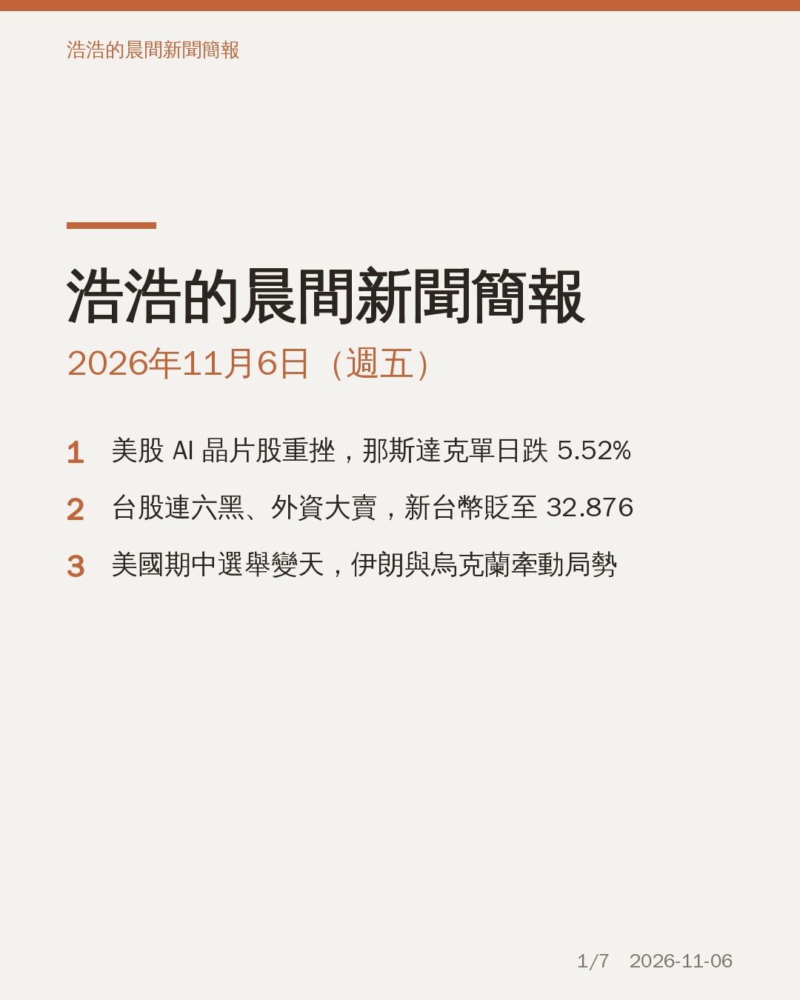
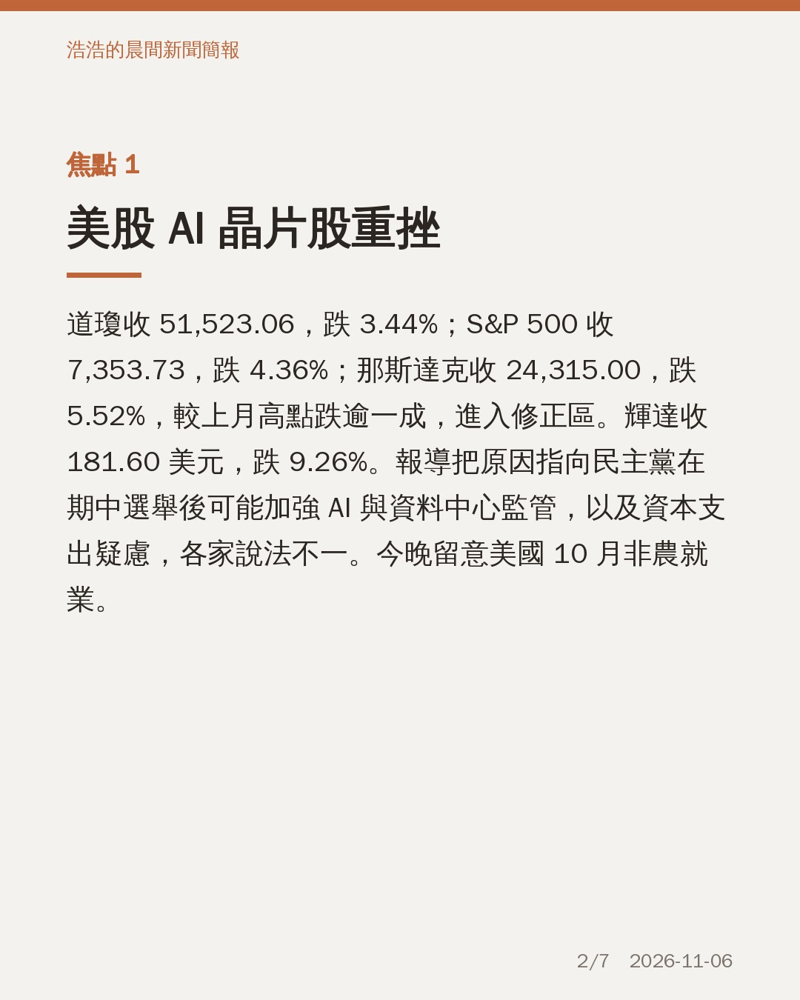
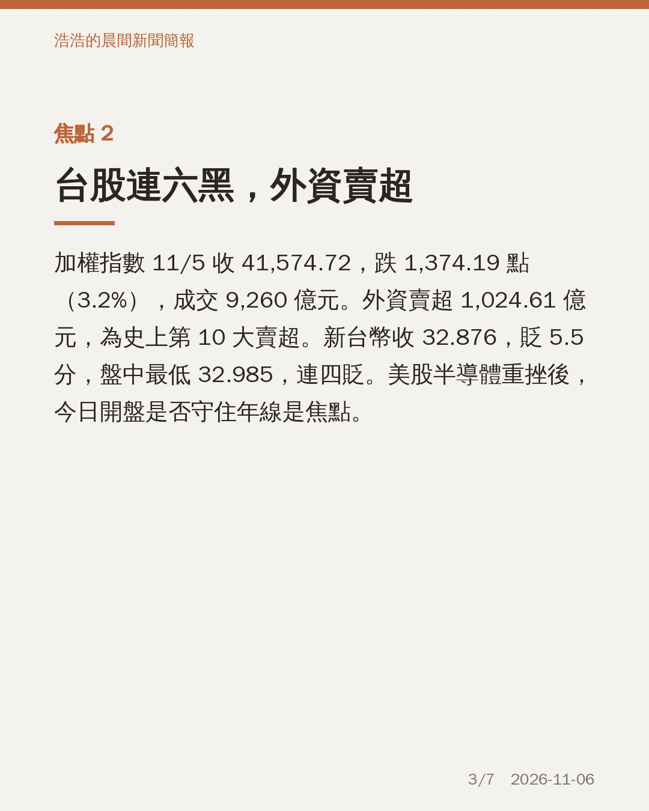
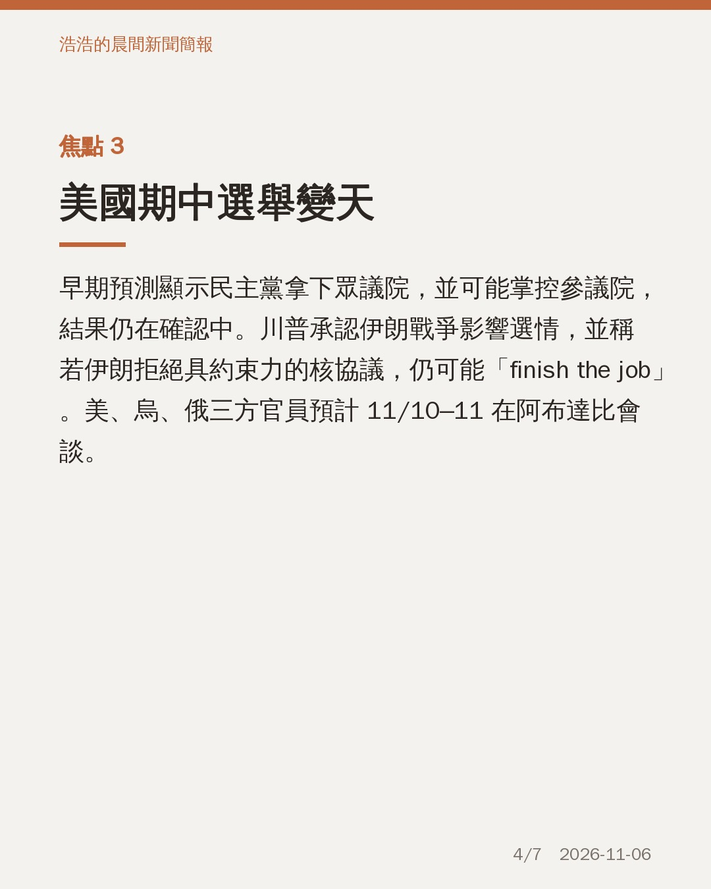
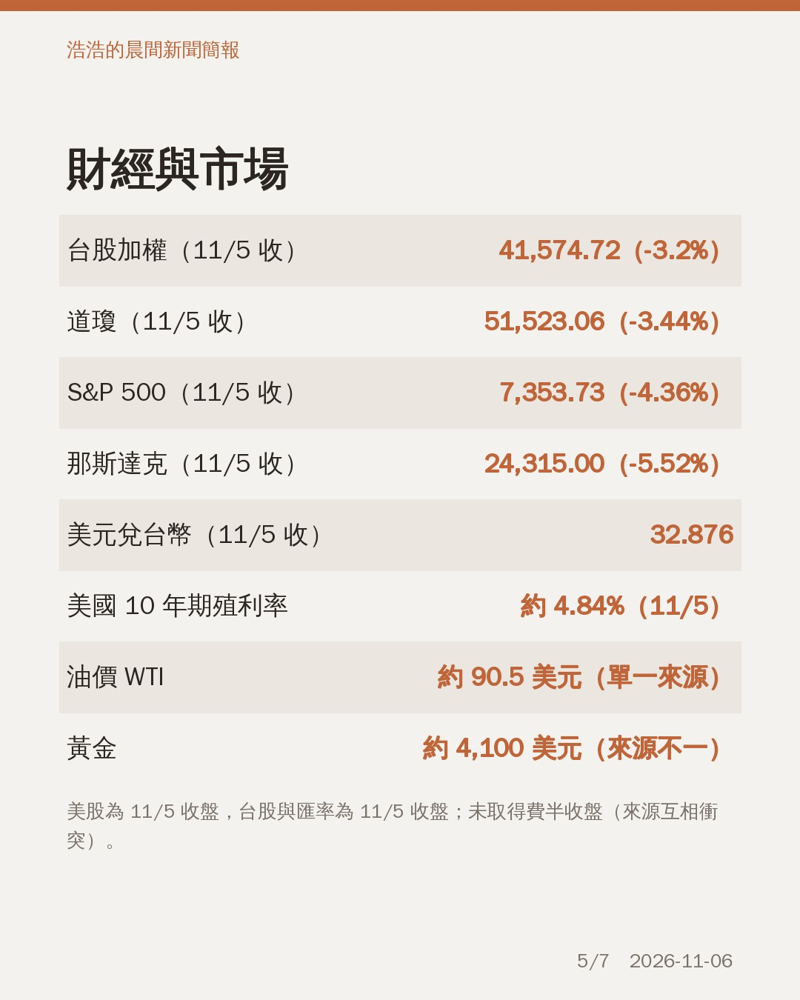
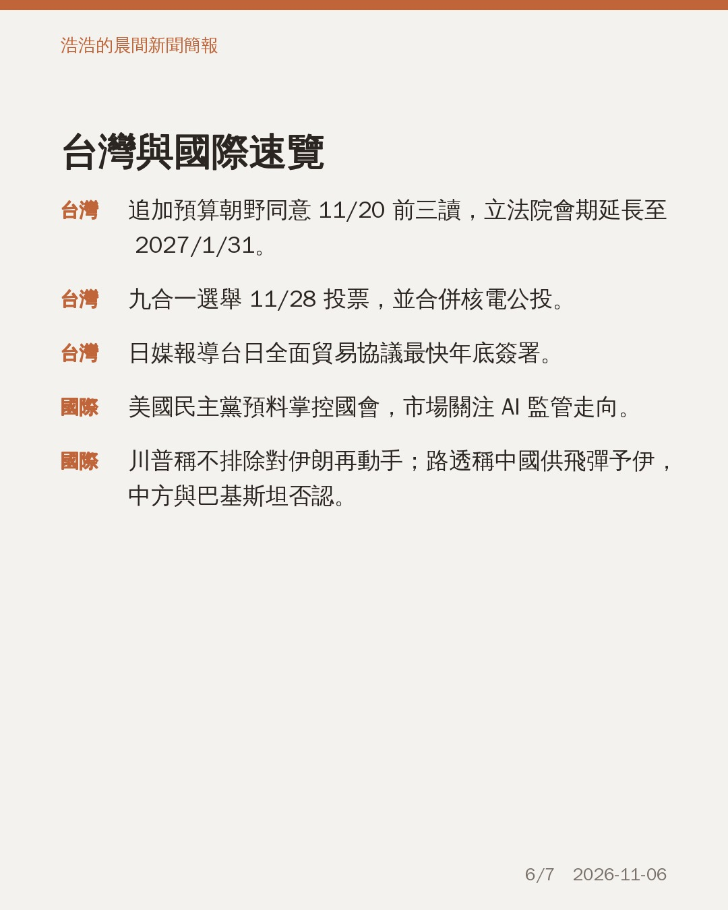
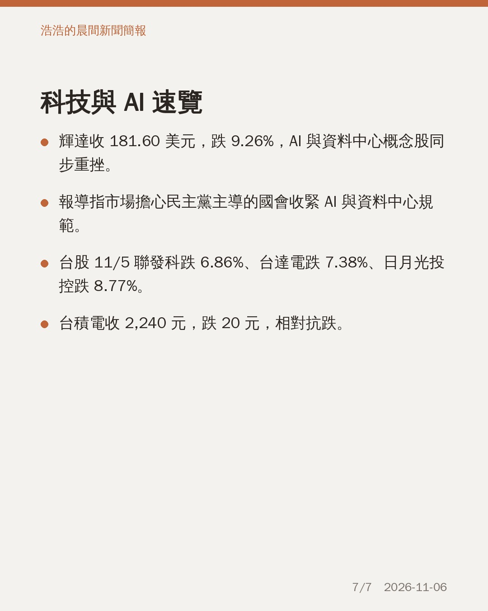

# 晨間新聞簡報｜2026年11月6日（週五）

## 今日三大焦點
1. 美股 AI 晶片股重挫：那斯達克跌 5.52% 至 24,315.00，輝達跌 9.26%，報導指與民主黨掌控國會後的 AI 監管疑慮有關。
2. 台股連六黑：加權指數收 41,574.72，跌 1,374.19 點；外資賣超 1,024.61 億元，新台幣收 32.876。
3. 美國期中選舉變天：民主黨預料掌控國會，川普稱若伊朗拒絕核協議仍可能動手，美烏俄 11/10–11 擬於阿布達比會談。

## 圖卡

