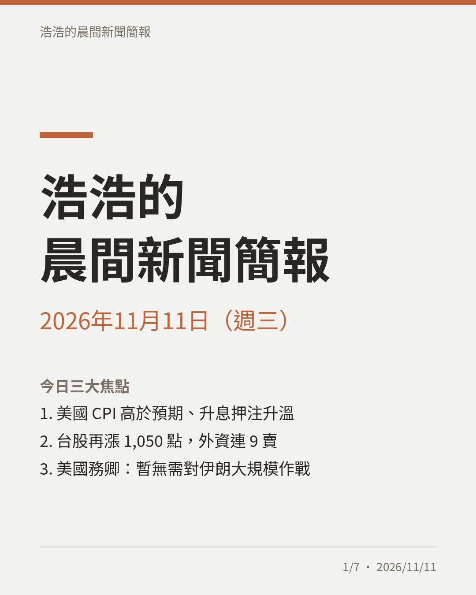
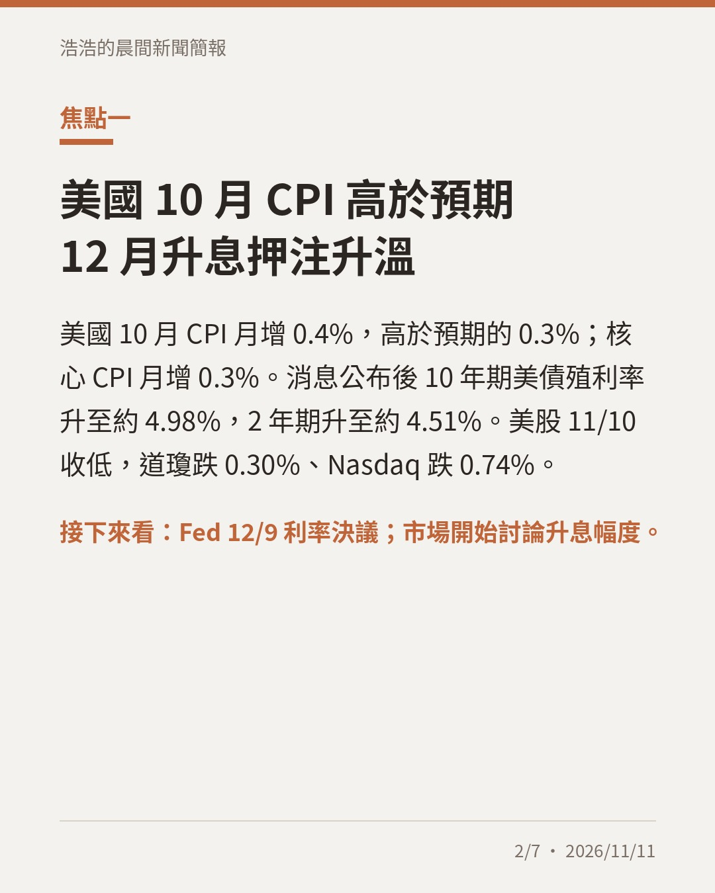
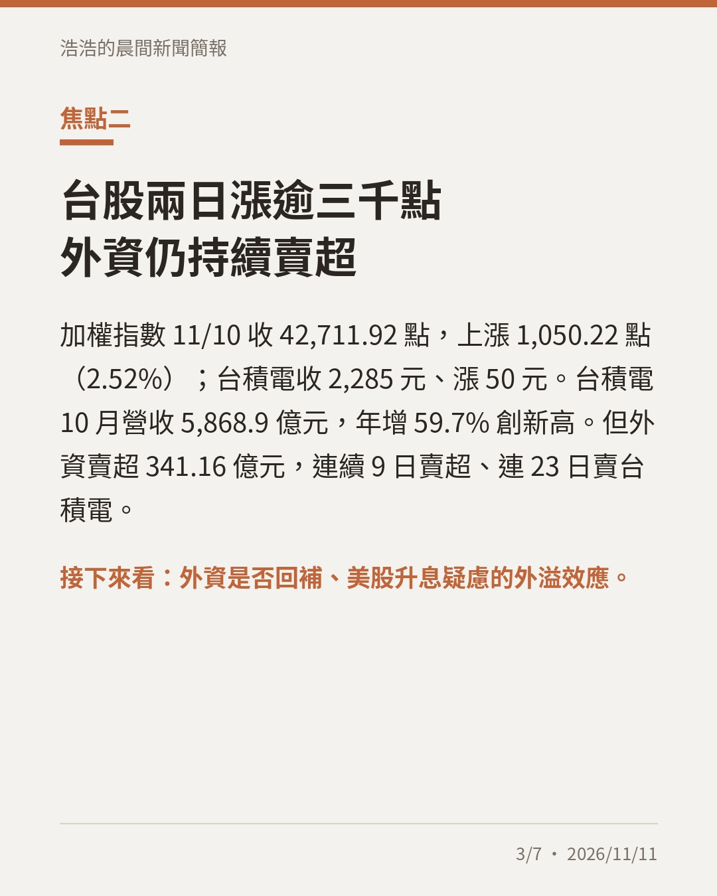
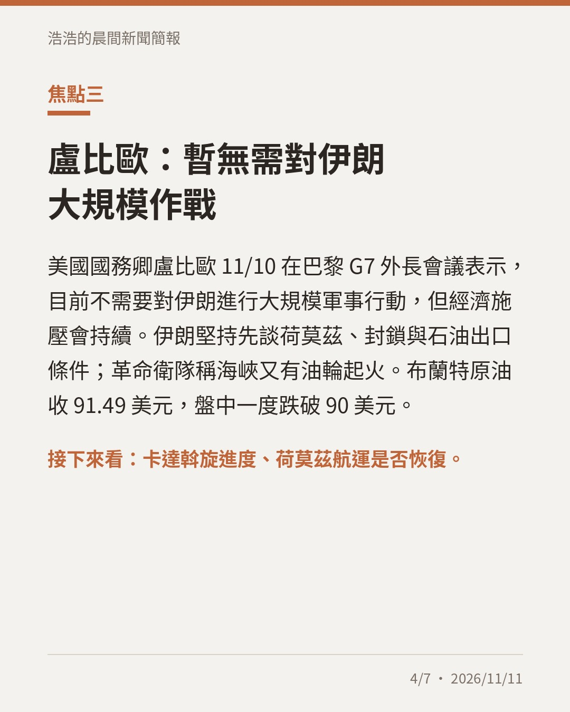
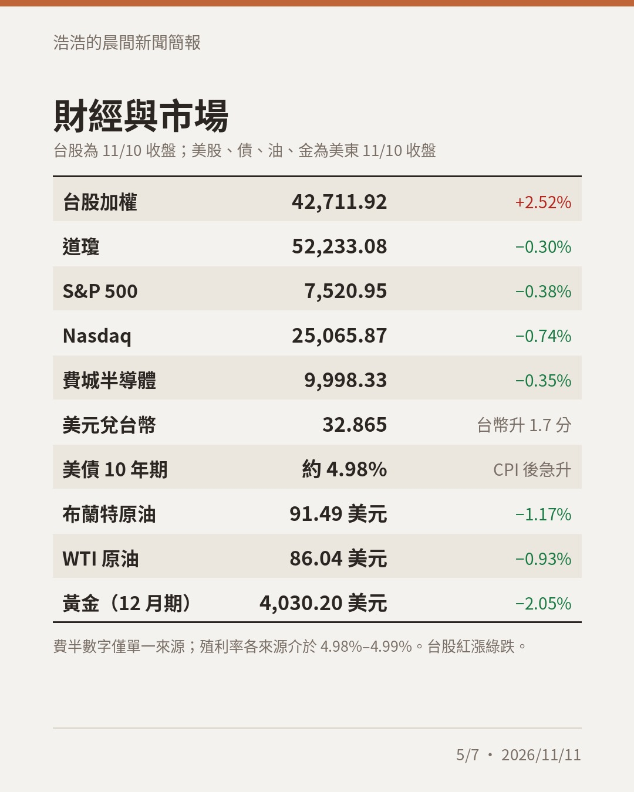
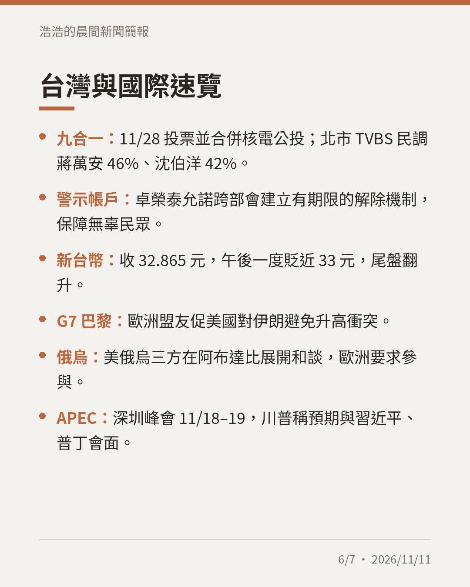
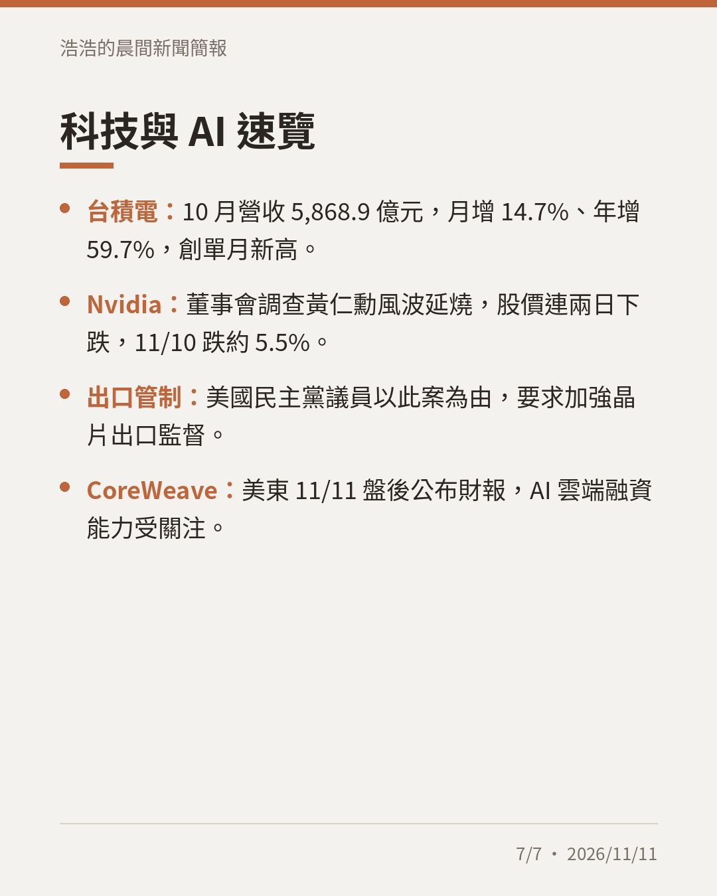

# 晨間新聞簡報｜2026年11月11日（週三）

## 今日三大焦點

1. 美國 10 月 CPI 月增 0.4% 高於預期，12 月升息押注升溫，美股 11/10 收低、10 年期美債殖利率約 4.98%。
2. 台股 11/10 再漲 1,050.22 點收 42,711.92，台積電 10 月營收 5,868.9 億元創新高，但外資連 9 日賣超。
3. 美國務卿盧比歐在 G7 表示暫無需對伊朗大規模作戰，布蘭特原油收 91.49 美元。

## 圖卡

完整簡報：https://claude.ai/artifact/LeR1TRnBNkeundPw1ALTqe
