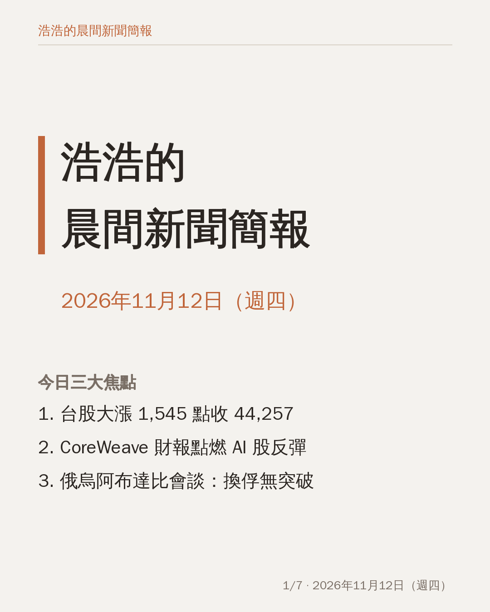
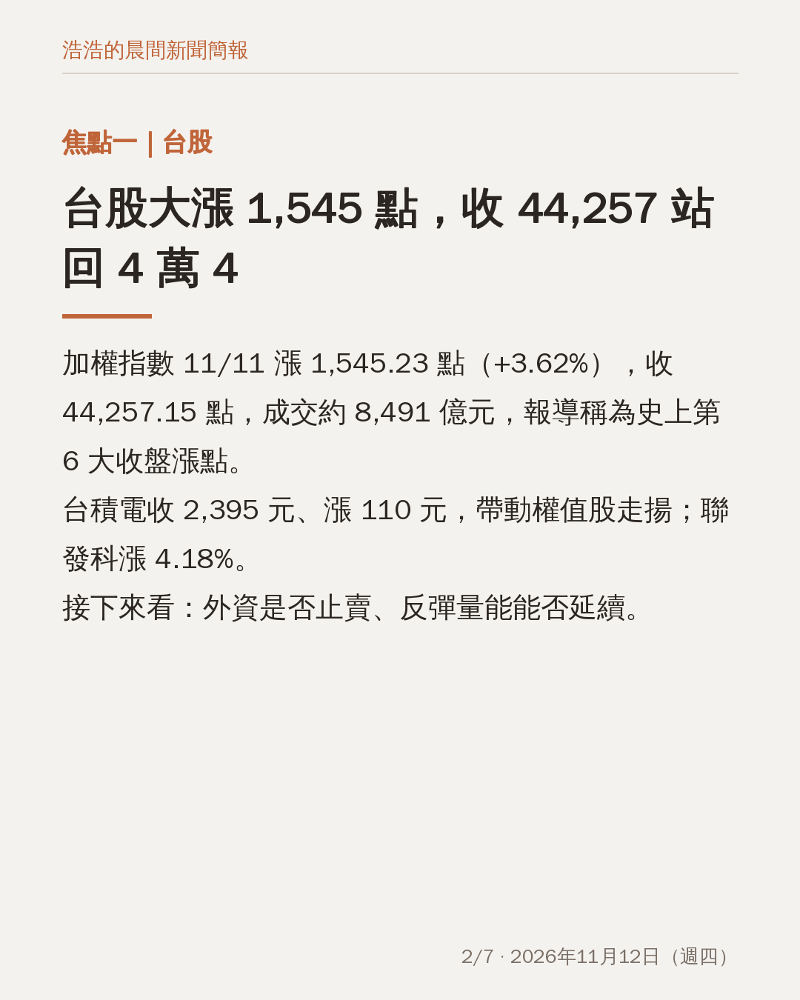
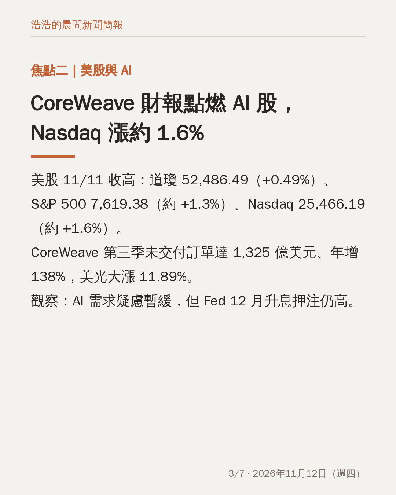
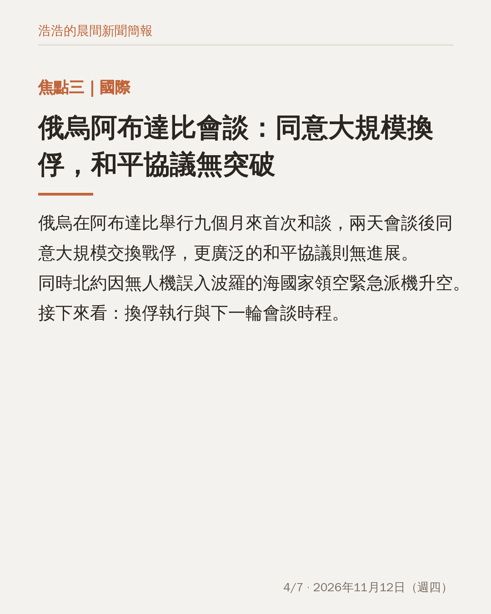
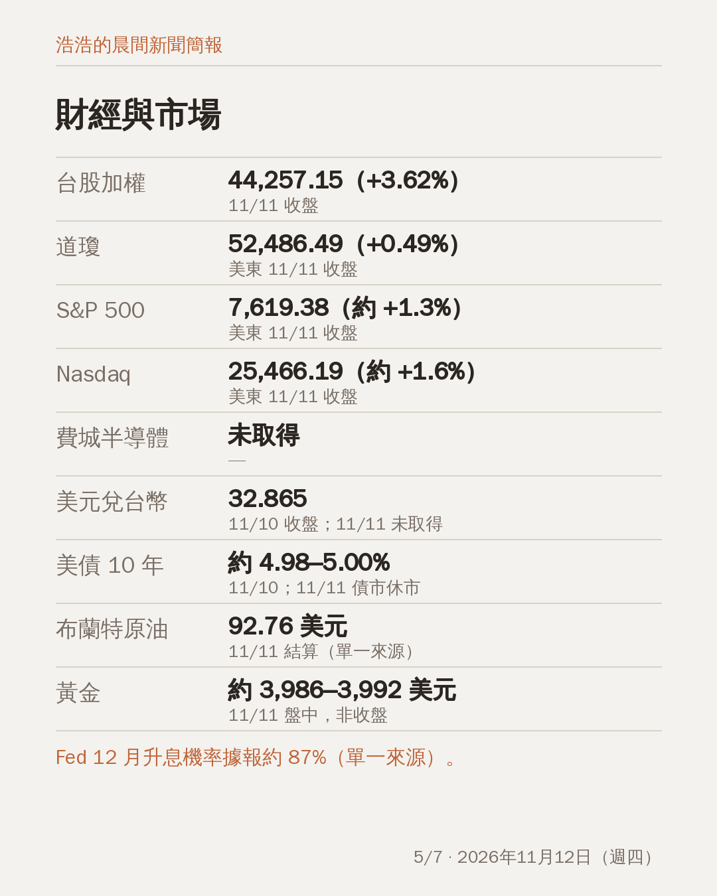
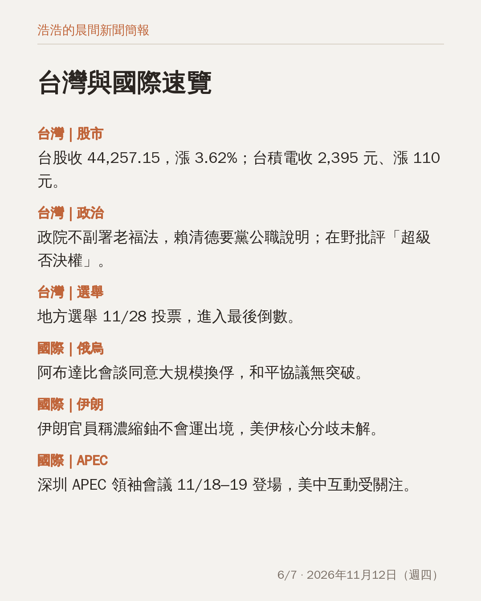
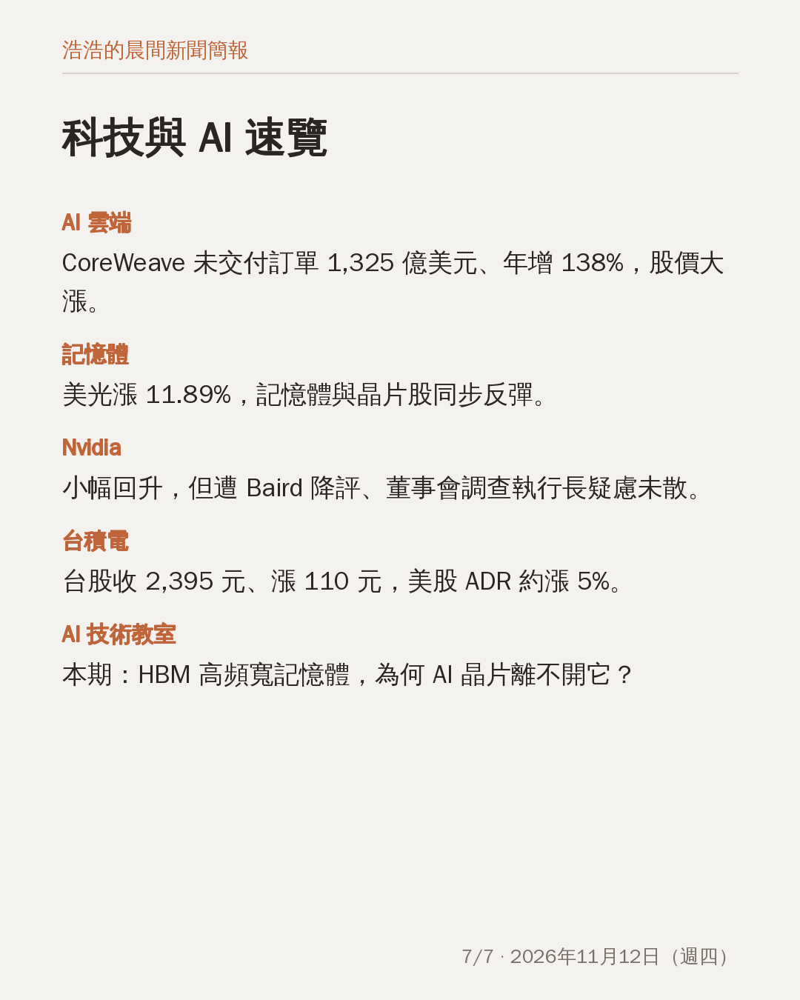

# 晨間新聞簡報｜2026年11月12日（週四）

**今日三大焦點**

1. 台股 11/11 大漲 1,545.23 點（+3.62%）收 44,257.15，台積電收 2,395 元、漲 110 元。
2. CoreWeave 財報優於預期帶動 AI 股反彈，美股 11/11 收高，Nasdaq 收 25,466.19（約 +1.6%）。
3. 俄烏在阿布達比舉行九個月來首次和談，同意大規模換俘，和平協議無突破。

完整簡報：https://claude.ai/artifact/LeR1TRnBNkeundPw1ALTqe

