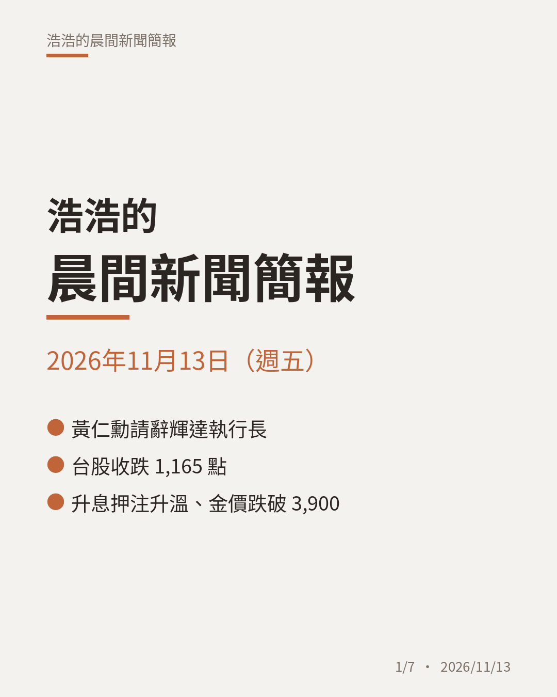
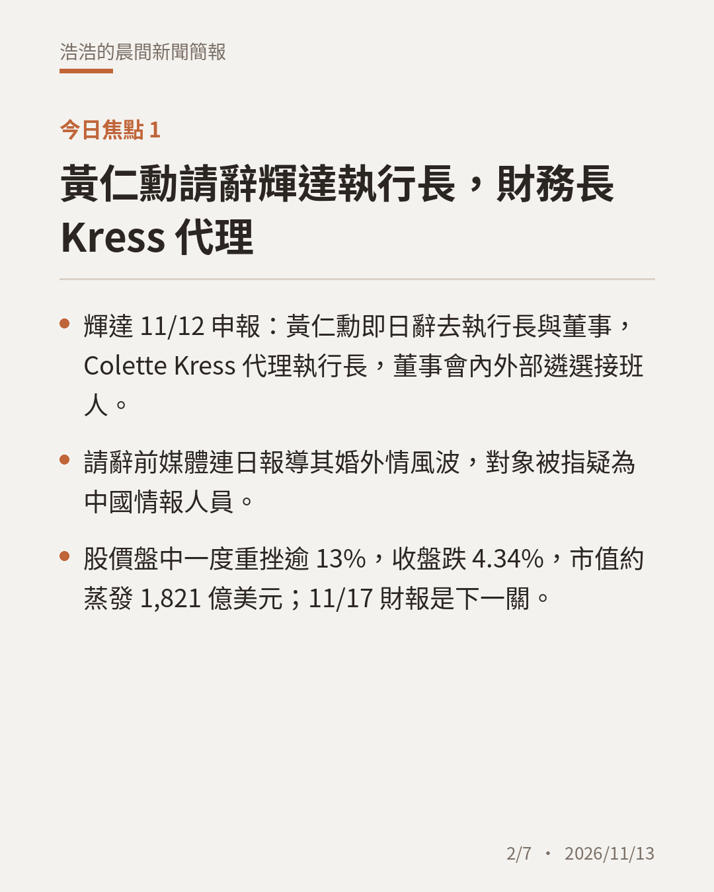
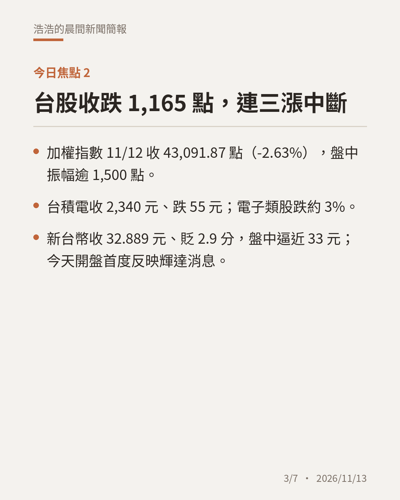
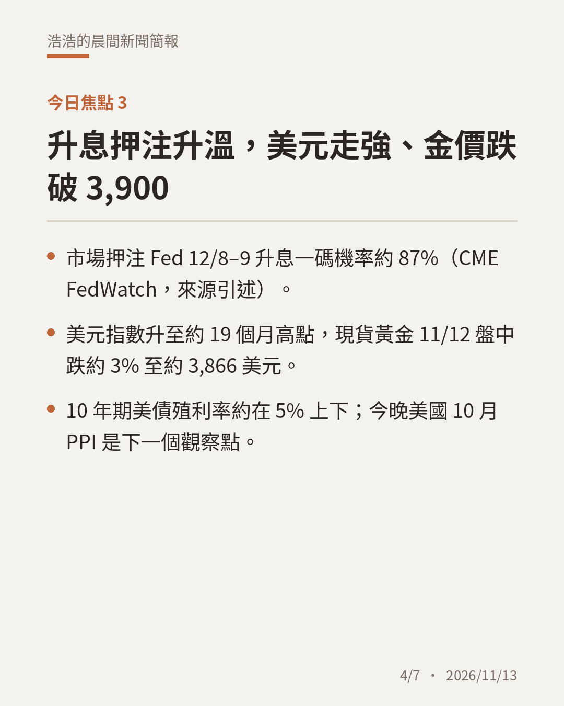
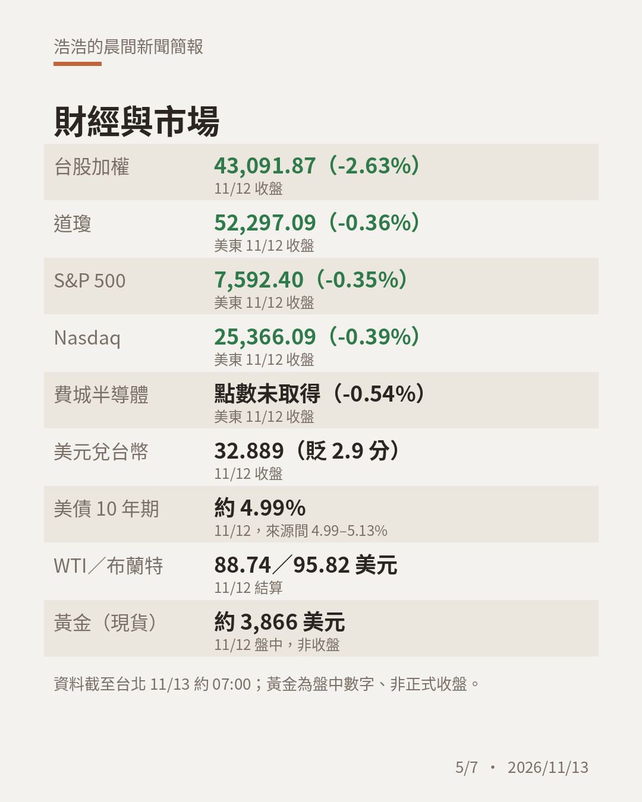
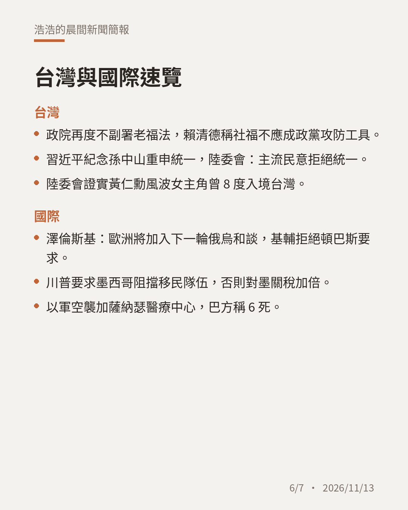
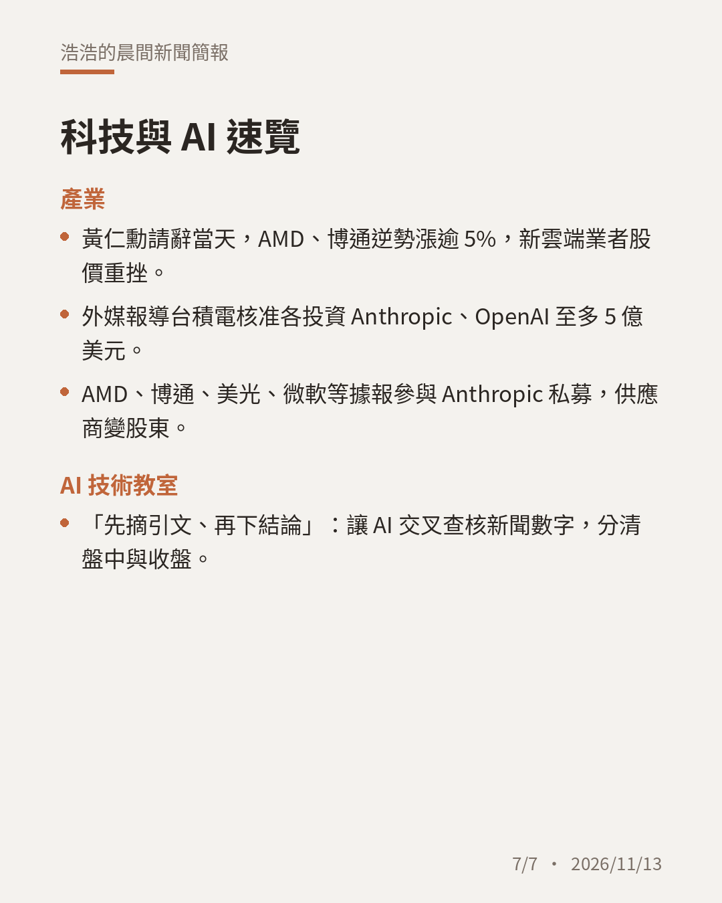

# 晨間新聞簡報｜2026年11月13日（週五）

**今日三大焦點**

1. 黃仁勳請辭輝達執行長，財務長 Kress 代理；輝達收跌 4.34%、市值約蒸發 1,821 億美元。
2. 台股 11/12 收跌 1,165.28 點收 43,091.87，台積電收 2,340 元；新台幣收 32.889 元。
3. Fed 12 月升息押注約 87%，美元升至約 19 個月高點、黃金盤中跌至約 3,866 美元。

完整簡報：https://claude.ai/artifact/LeR1TRnBNkeundPw1ALTqe

