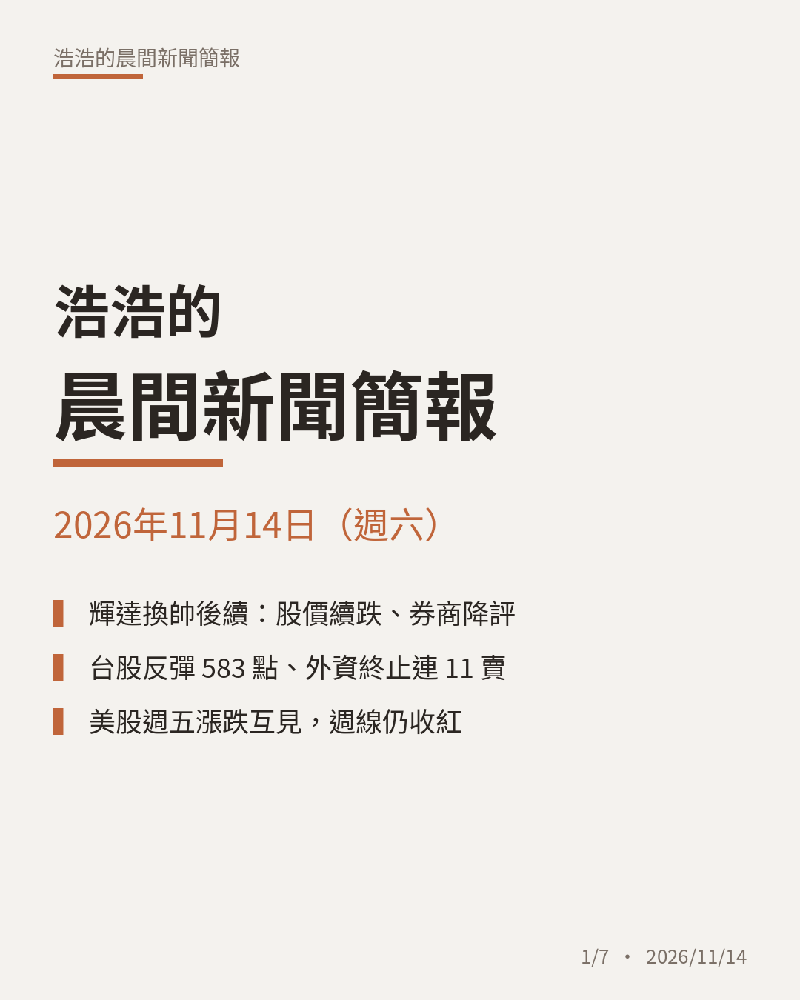
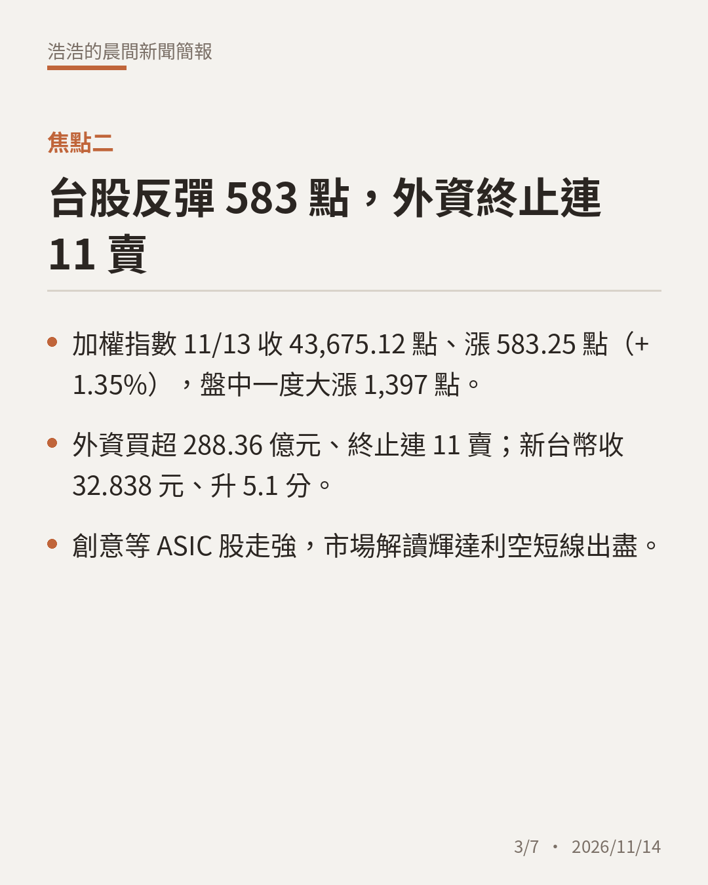
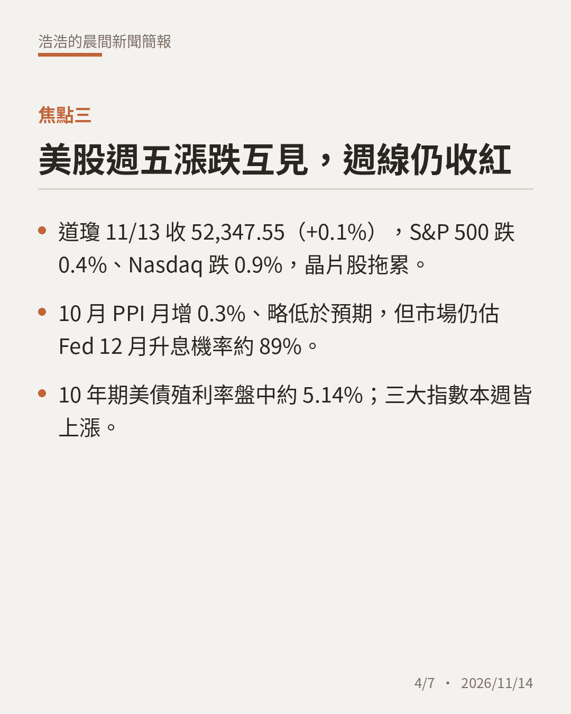
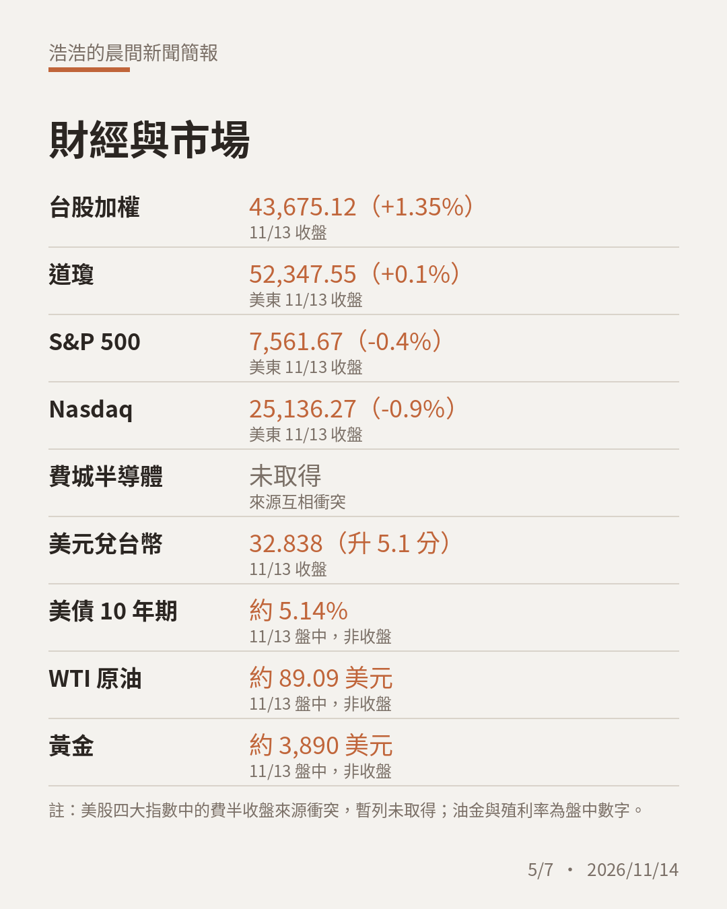
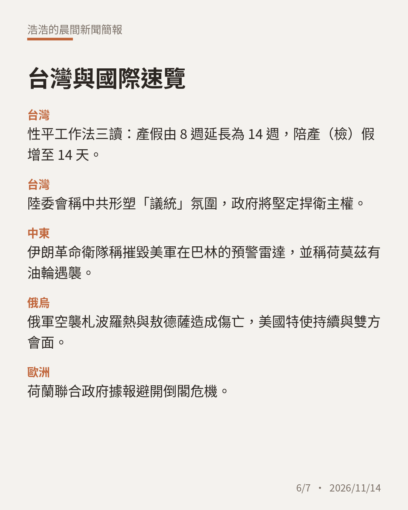

# 晨間新聞簡報｜2026年11月14日（週六）

**今日三大焦點**

1. 黃仁勳請辭後 Kress 代理執行長，輝達 11/13 收 162.85 美元、跌 2.01%，多家券商降評。
2. 台股 11/13 反彈 583.25 點收 43,675.12，外資終止連 11 賣，新台幣收 32.838 元。
3. 美股週五漲跌互見、三大指數週線收紅，Fed 12 月升息押注約 89%。

完整簡報：https://claude.ai/artifact/LeR1TRnBNkeundPw1ALTqe

