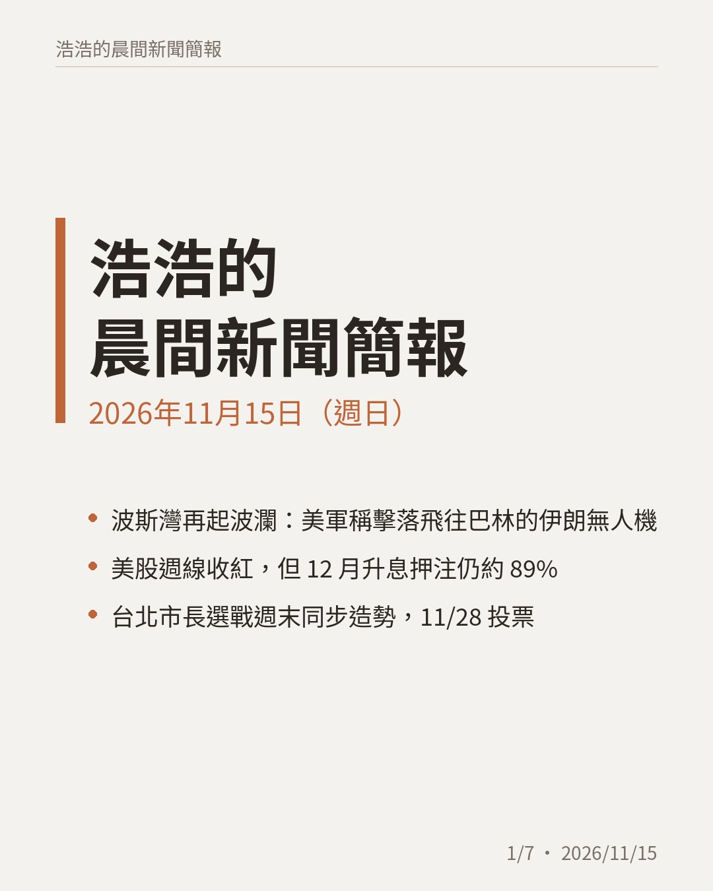
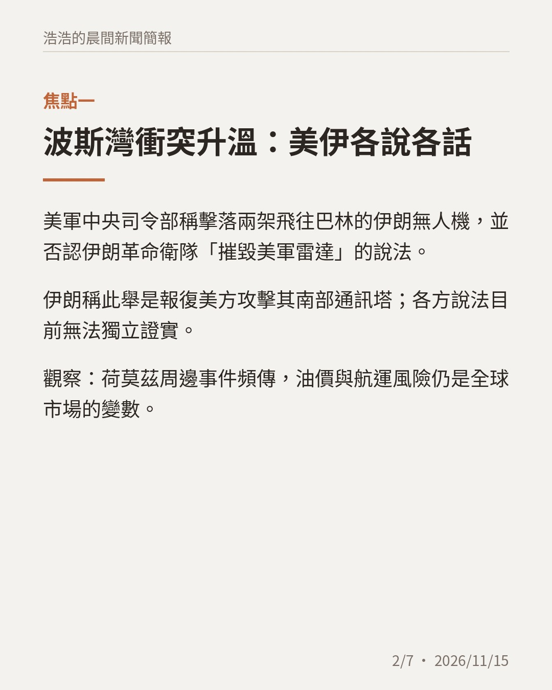
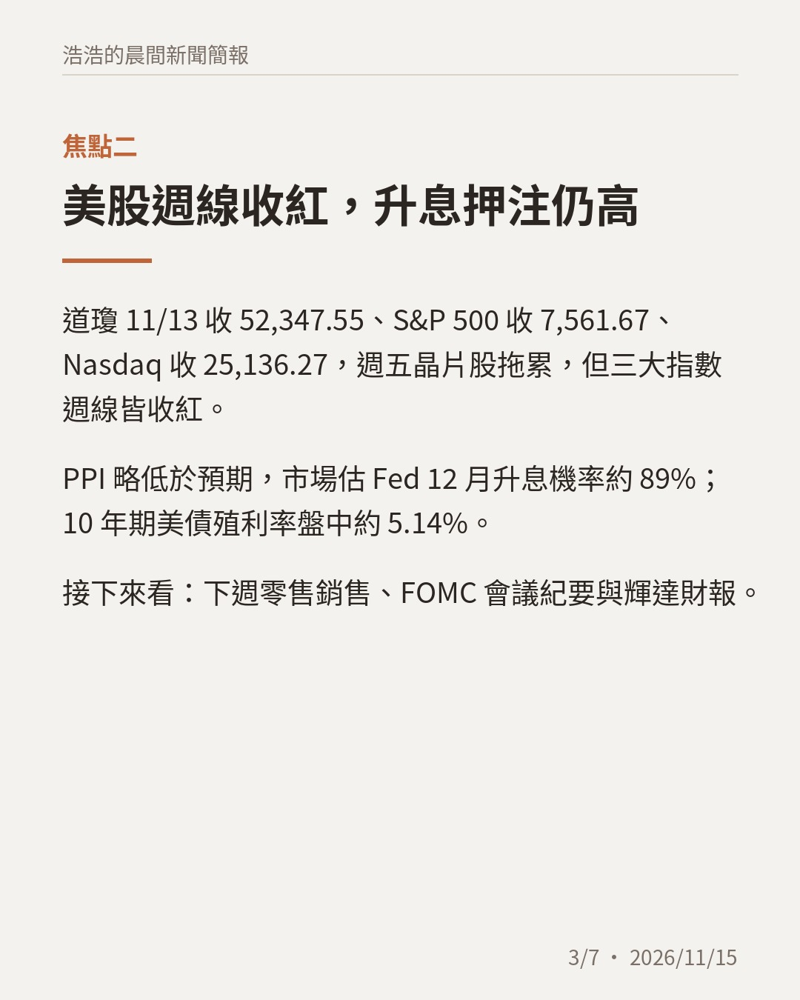
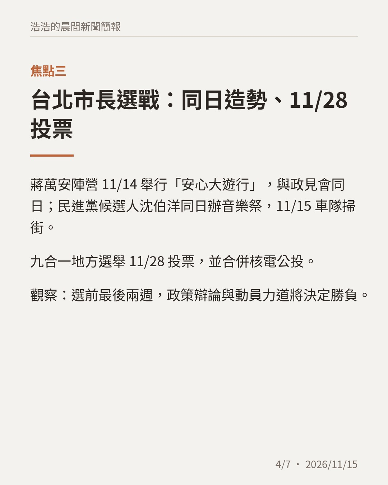
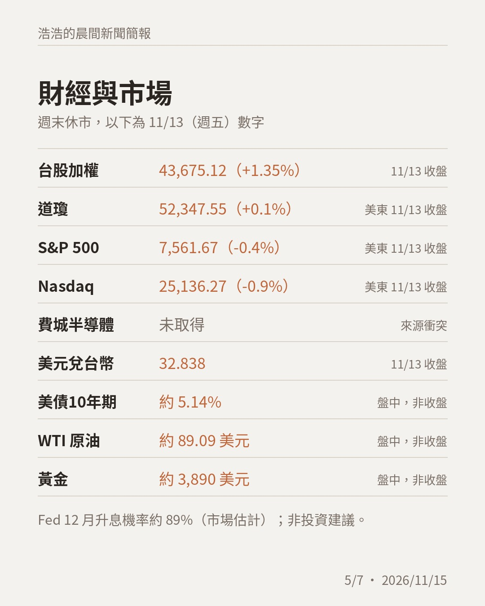
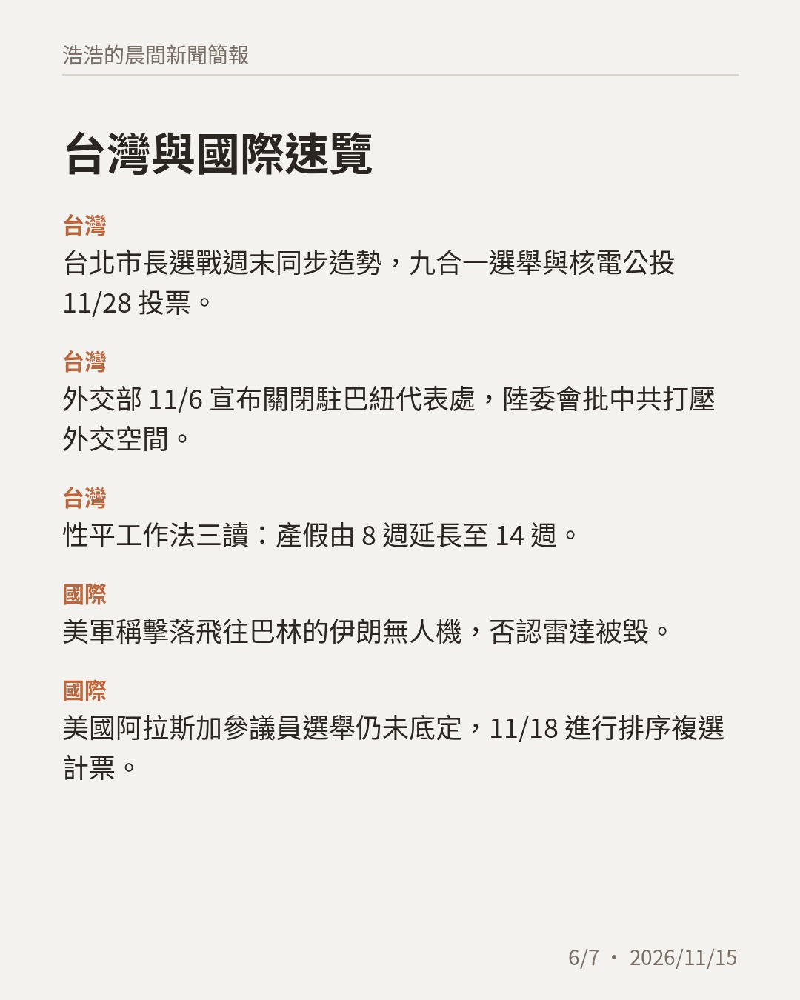

# 晨間新聞簡報｜2026年11月15日（週日）

## 今日三大焦點
1. 美軍稱擊落飛往巴林的伊朗無人機，否認伊朗「摧毀美軍雷達」說法。
2. 美股 11/13 漲跌互見但週線收紅，Fed 12 月升息押注約 89%。
3. 台北市長選戰週末同步造勢，九合一與核電公投 11/28 投票。

## 圖卡

完整簡報：https://claude.ai/artifact/LeR1TRnBNkeundPw1ALTqe
