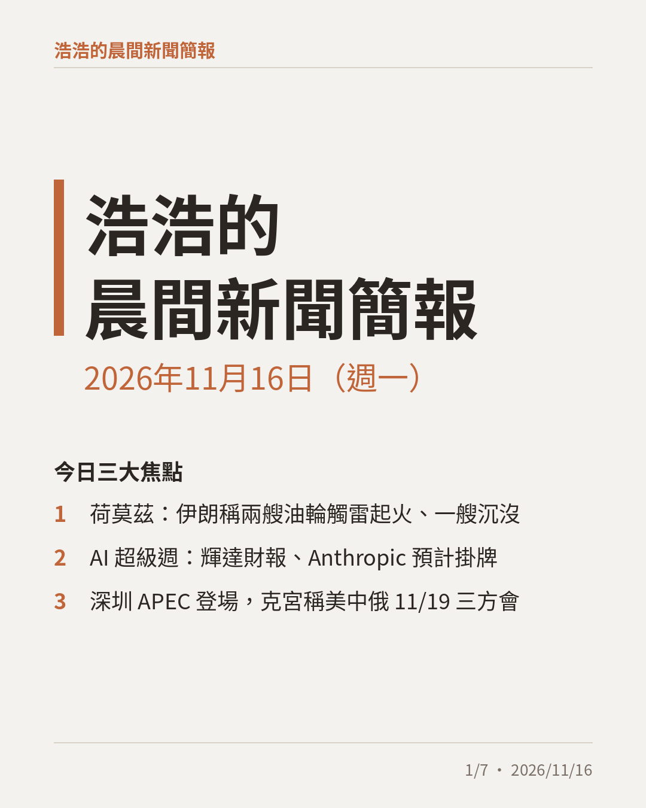
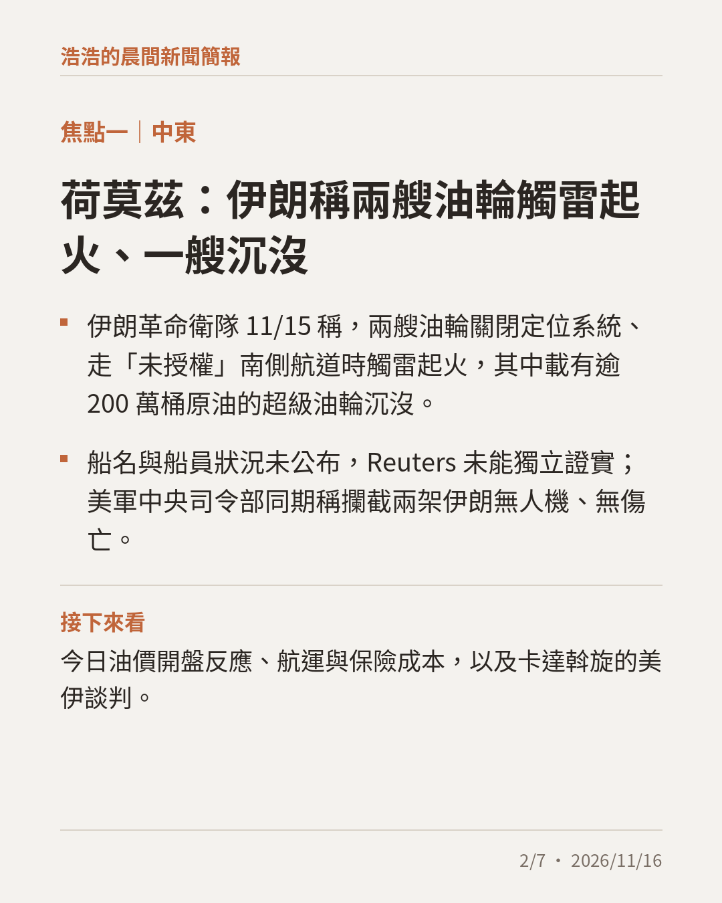
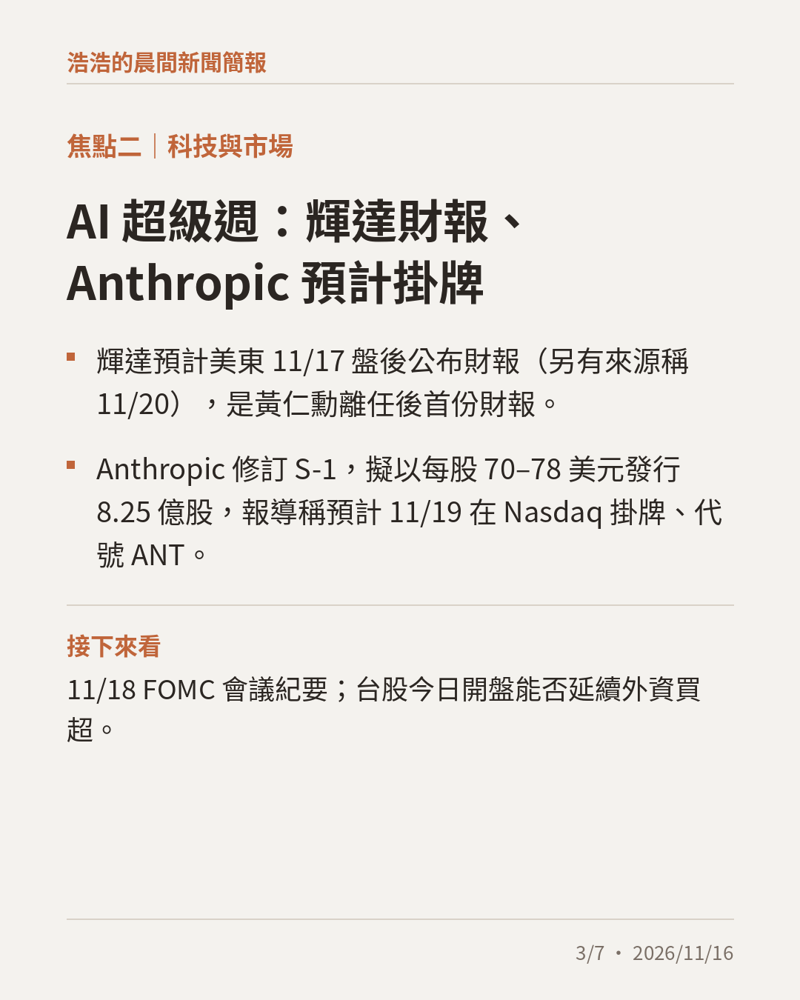
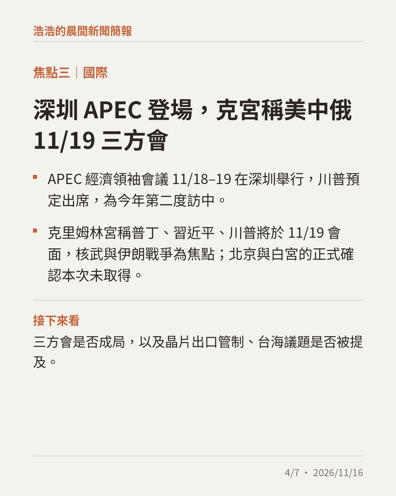
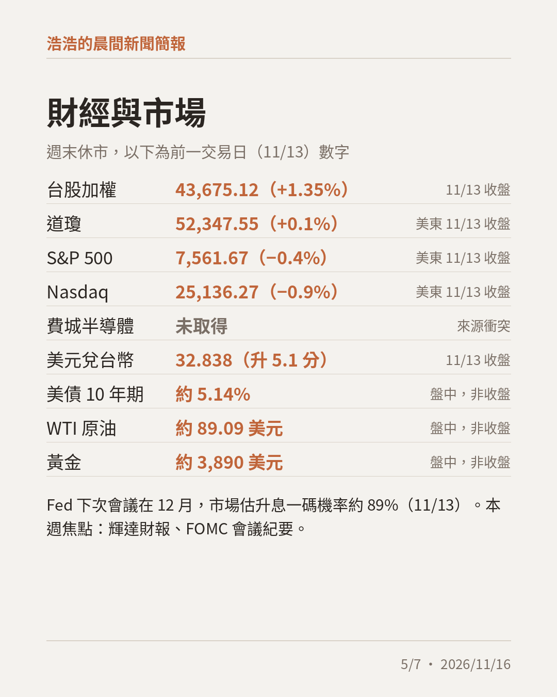
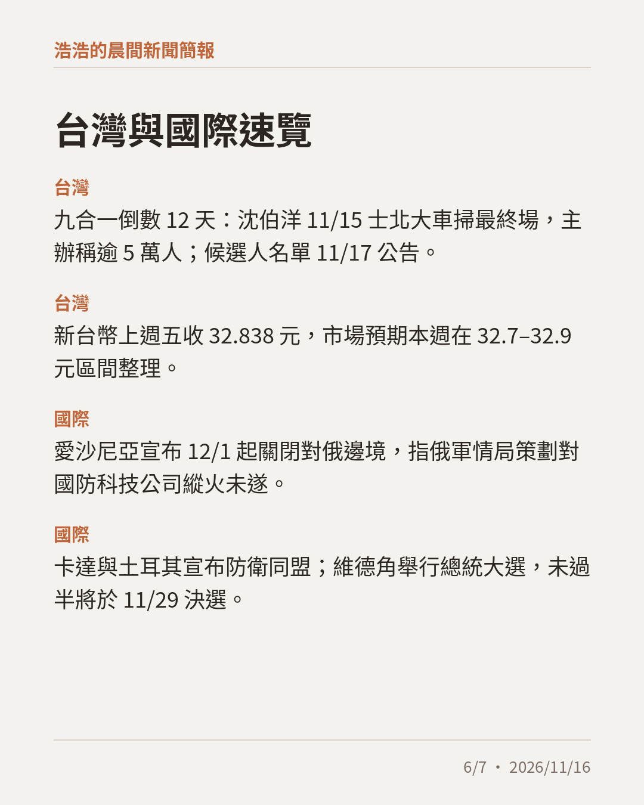
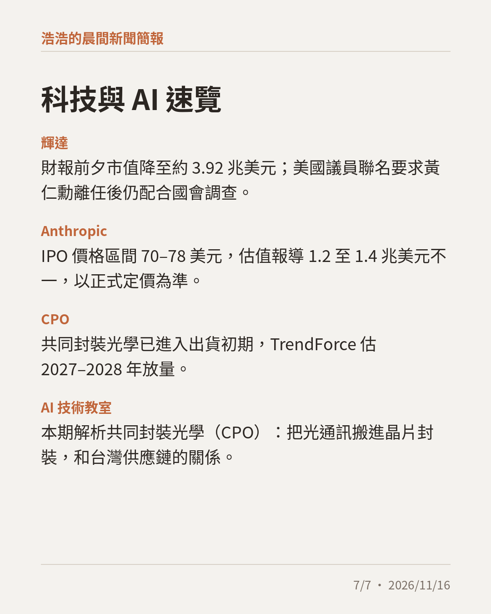

# 晨間新聞簡報｜2026年11月16日（週一）

**今日三大焦點**

1. 伊朗稱兩艘油輪在荷莫茲海峽觸雷起火、一艘沉沒，未獲獨立證實。
2. AI 超級週：輝達預計 11/17 公布財報（另說 11/20），Anthropic 報導稱 11/19 在 Nasdaq 掛牌。
3. 深圳 APEC 11/18–19 登場，克宮稱美中俄領袖 11/19 會面。

完整簡報：https://claude.ai/artifact/LeR1TRnBNkeundPw1ALTqe

