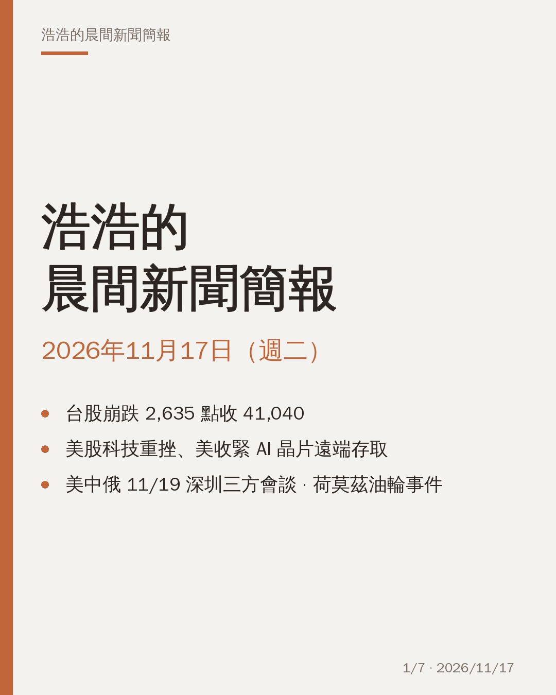
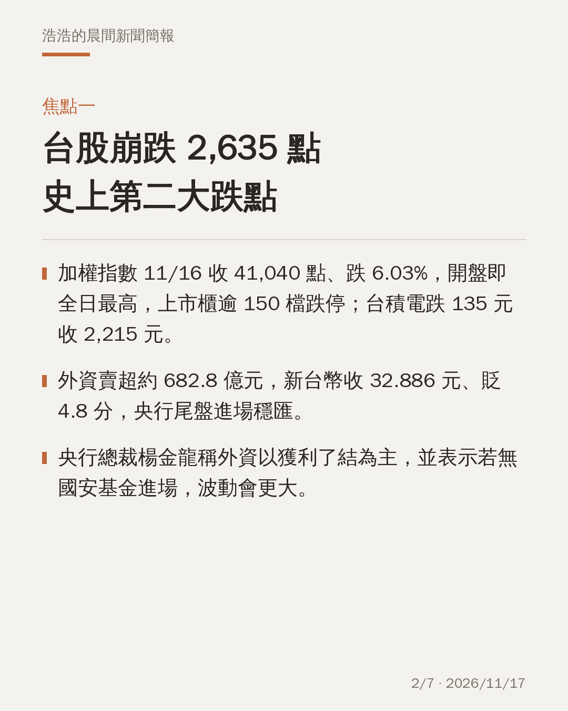
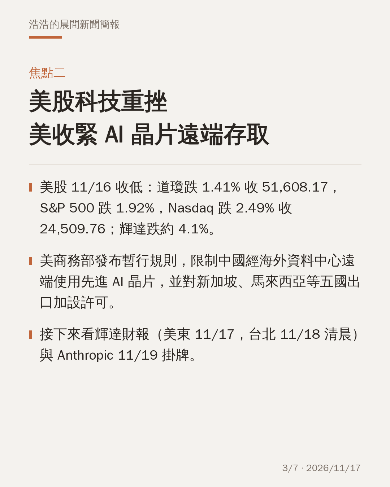
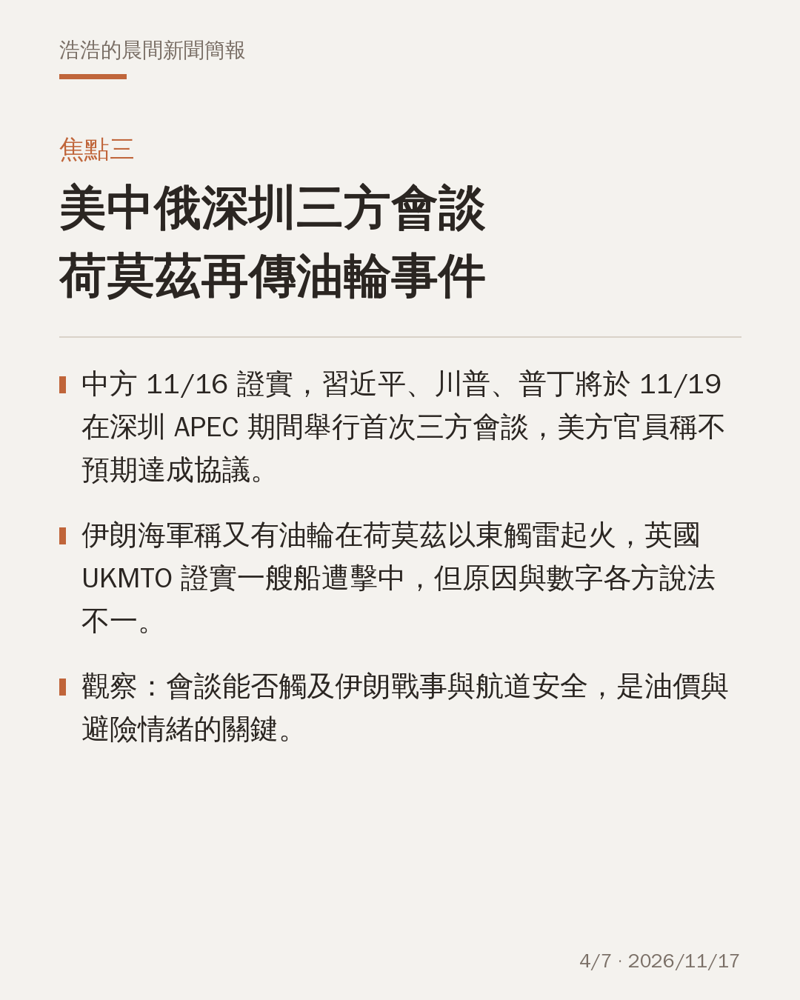
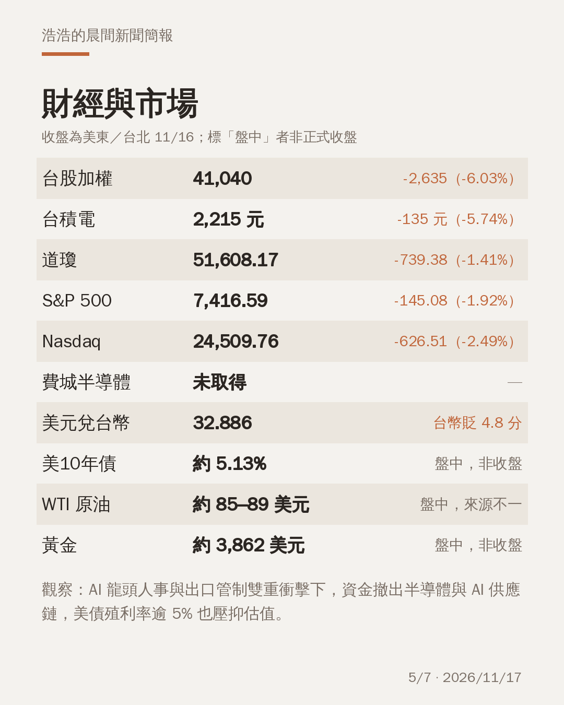
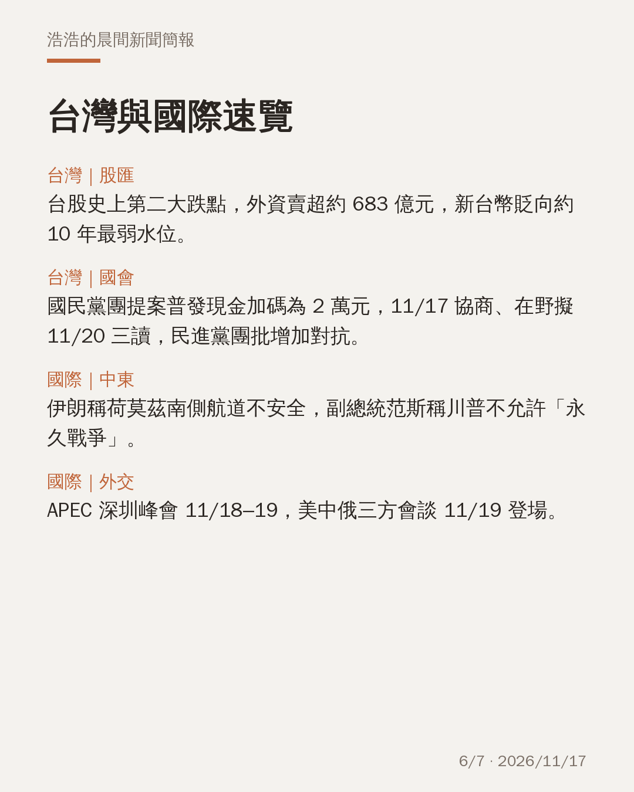
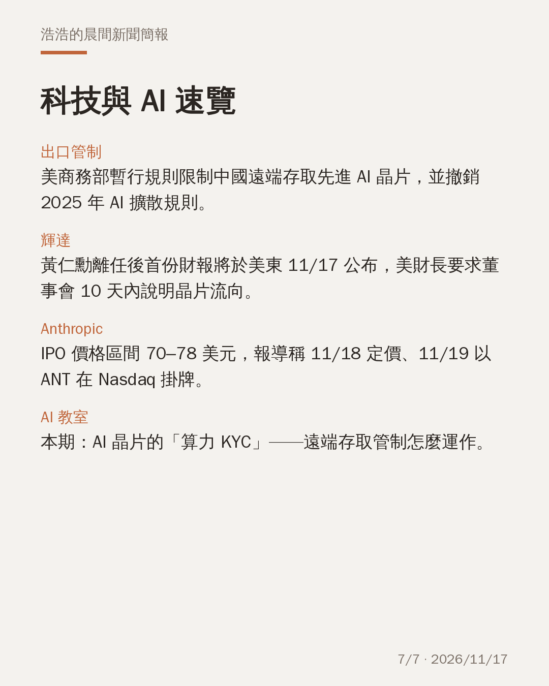

# 晨間新聞簡報｜2026年11月17日（週二）

**今日三大焦點**
1. 台股 11/16 崩跌 2,635 點（-6.03%）收 41,040，史上第二大跌點，外資賣超約 682.8 億元。
2. 美股科技重挫、Nasdaq 跌 2.49%；美商務部限制中國遠端存取先進 AI 晶片。
3. 美中俄 11/19 深圳三方會談；伊朗稱荷莫茲再有油輪觸雷（未獲獨立證實）。

完整簡報：https://claude.ai/artifact/LeR1TRnBNkeundPw1ALTqe

