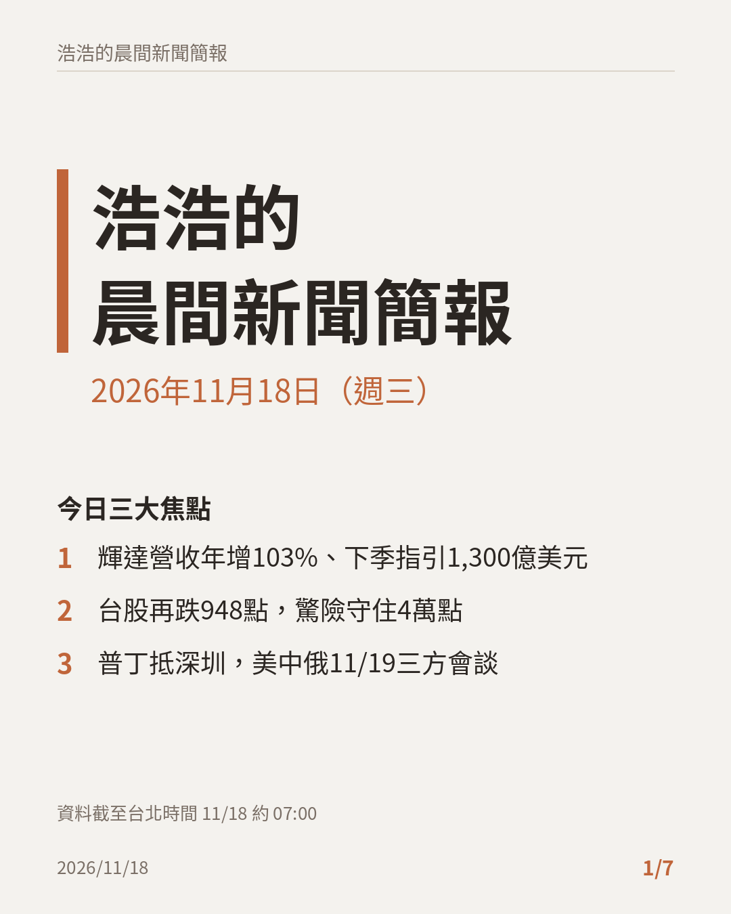
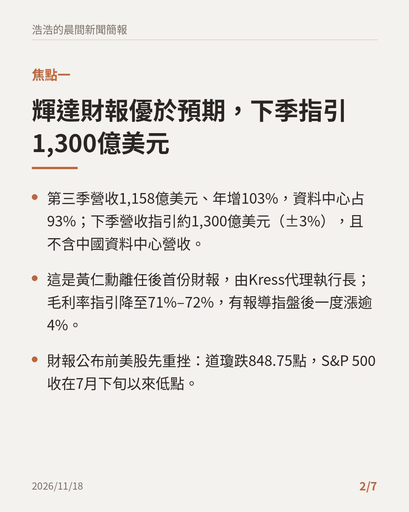
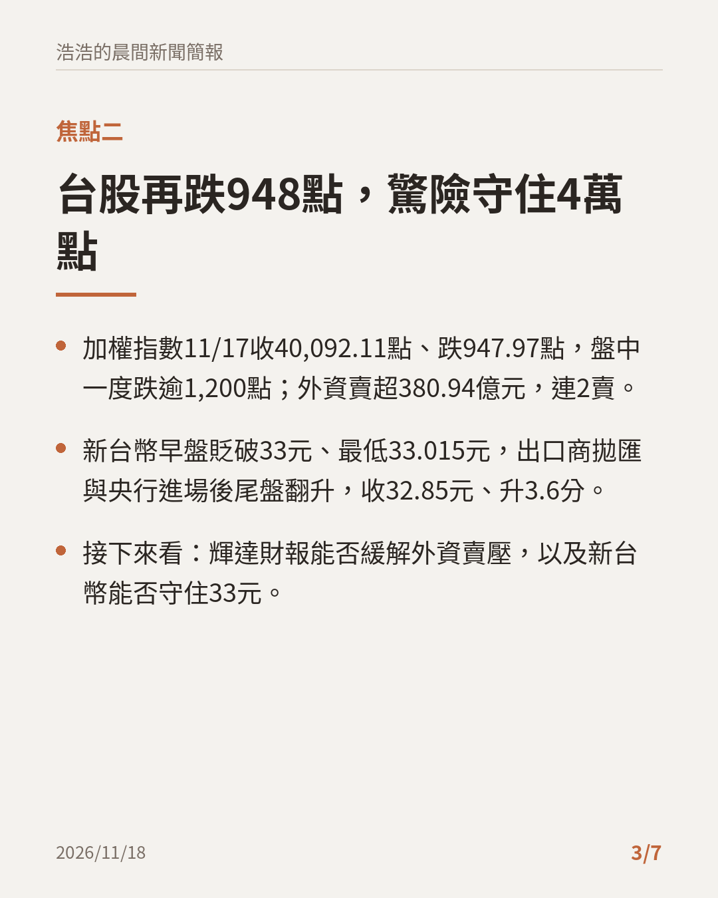
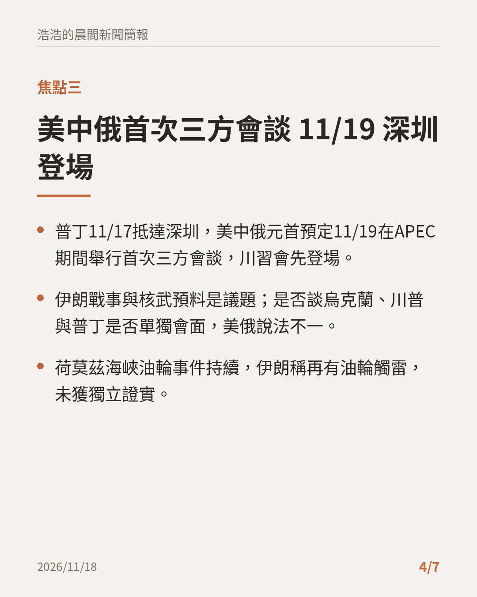
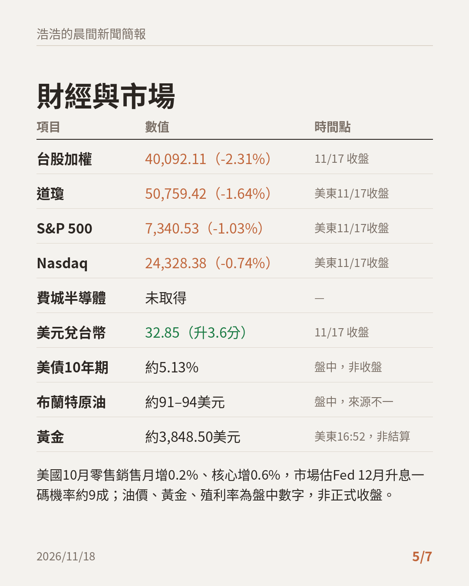
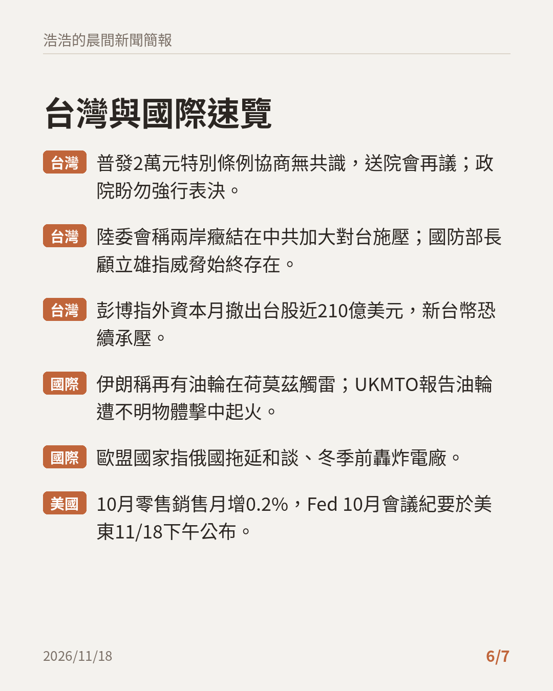

# 晨間新聞簡報｜2026年11月18日（週三）

## 今日三大焦點
1. 輝達第三季營收 1,158 億美元、年增 103%，下季指引約 1,300 億美元；財報前美股重挫。
2. 台股 11/17 再跌 947.97 點收 40,092.11，驚險守住 4 萬點；新台幣盤中貶破 33 元。
3. 普丁抵深圳，美中俄元首預定 11/19 舉行首次三方會談。

完整簡報：https://claude.ai/artifact/LeR1TRnBNkeundPw1ALTqe

## 圖卡

