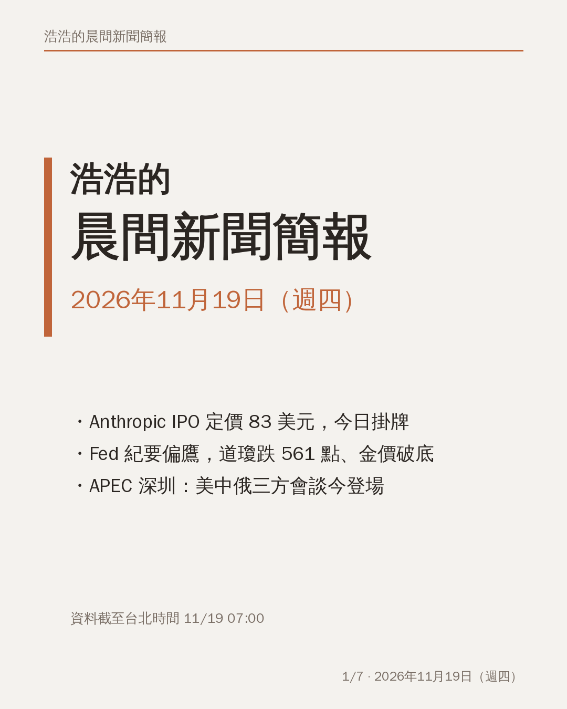
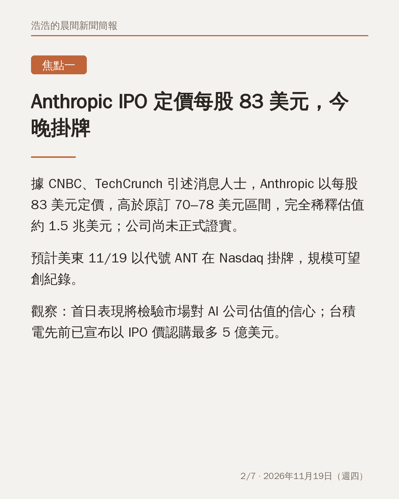
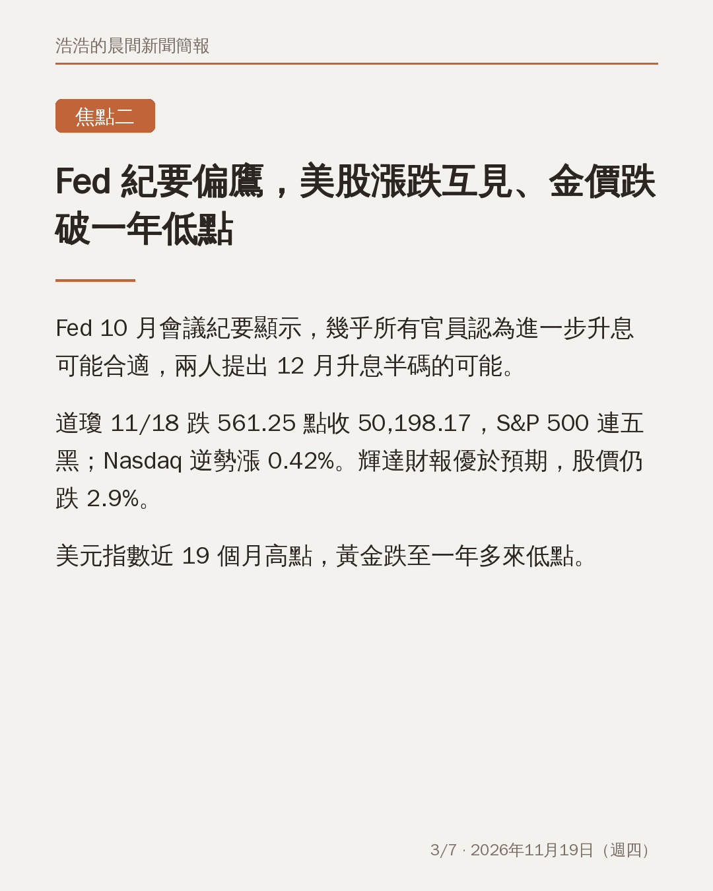
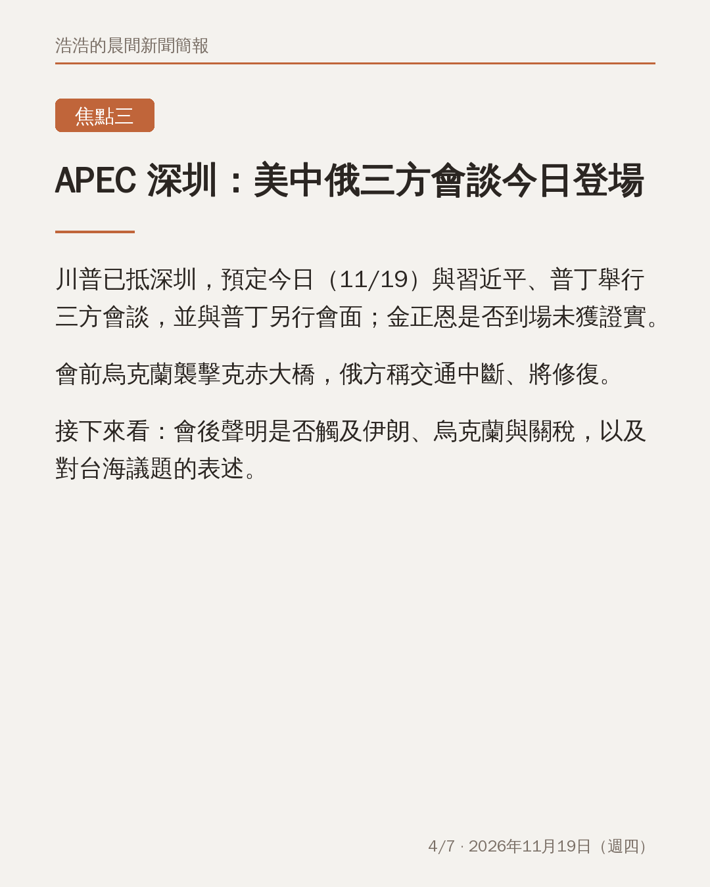
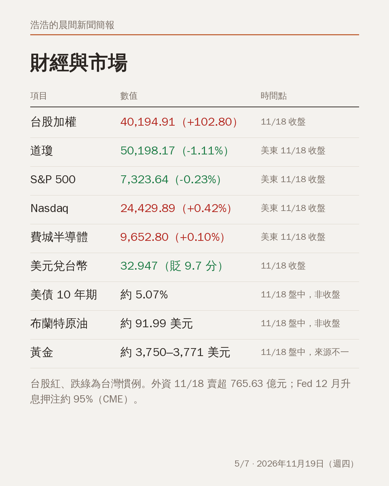
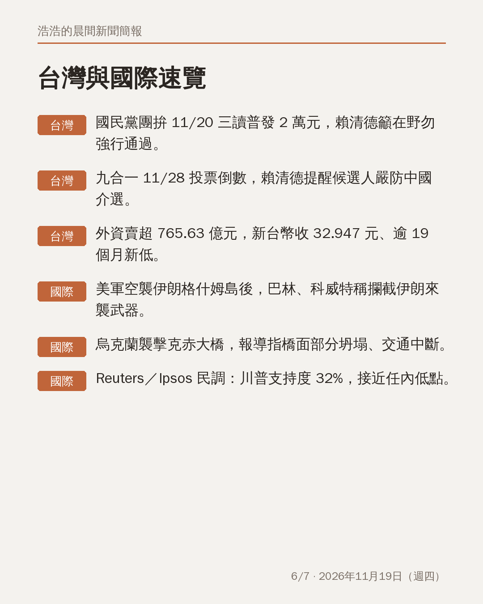
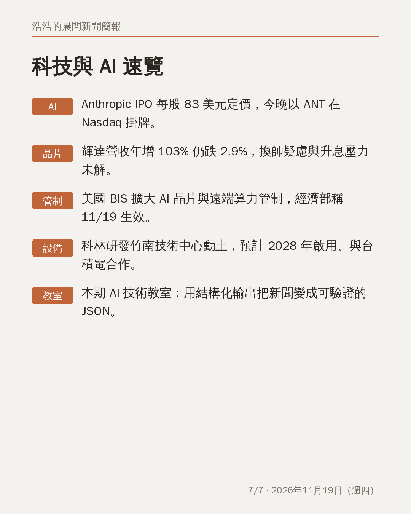

# 晨間新聞簡報｜2026年11月19日（週四）

## 今日三大焦點
1. Anthropic IPO 據報以每股 83 美元定價、高於 70–78 美元區間，今晚以 ANT 在 Nasdaq 掛牌。
2. Fed 會議紀要偏鷹，道瓊 11/18 跌 561.25 點收 50,198.17、Nasdaq 逆勢漲 0.42%；黃金跌至一年多低點。
3. APEC 深圳：美中俄三方會談今日（11/19）登場，川普另與普丁會面。

完整簡報：https://claude.ai/artifact/LeR1TRnBNkeundPw1ALTqe

## 圖卡

