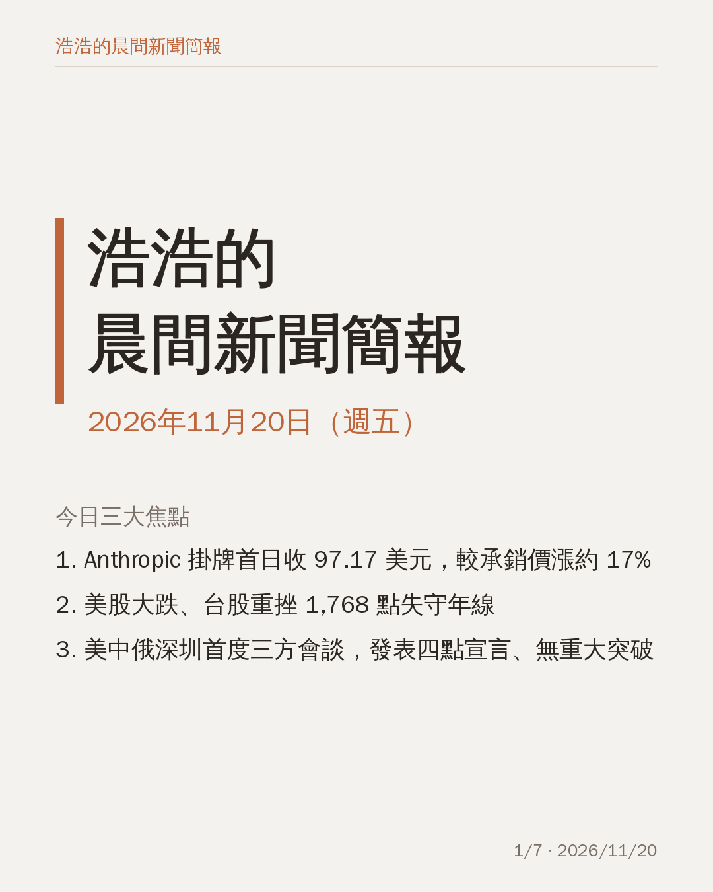
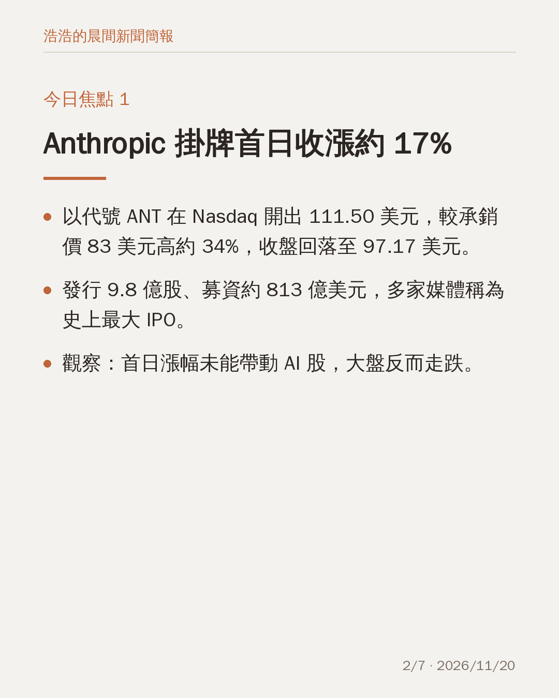
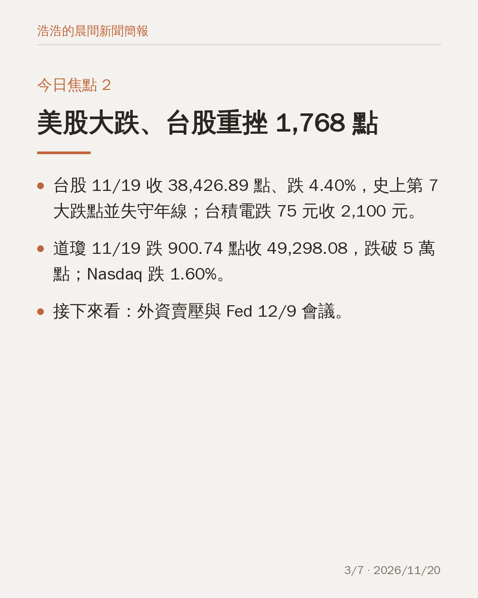
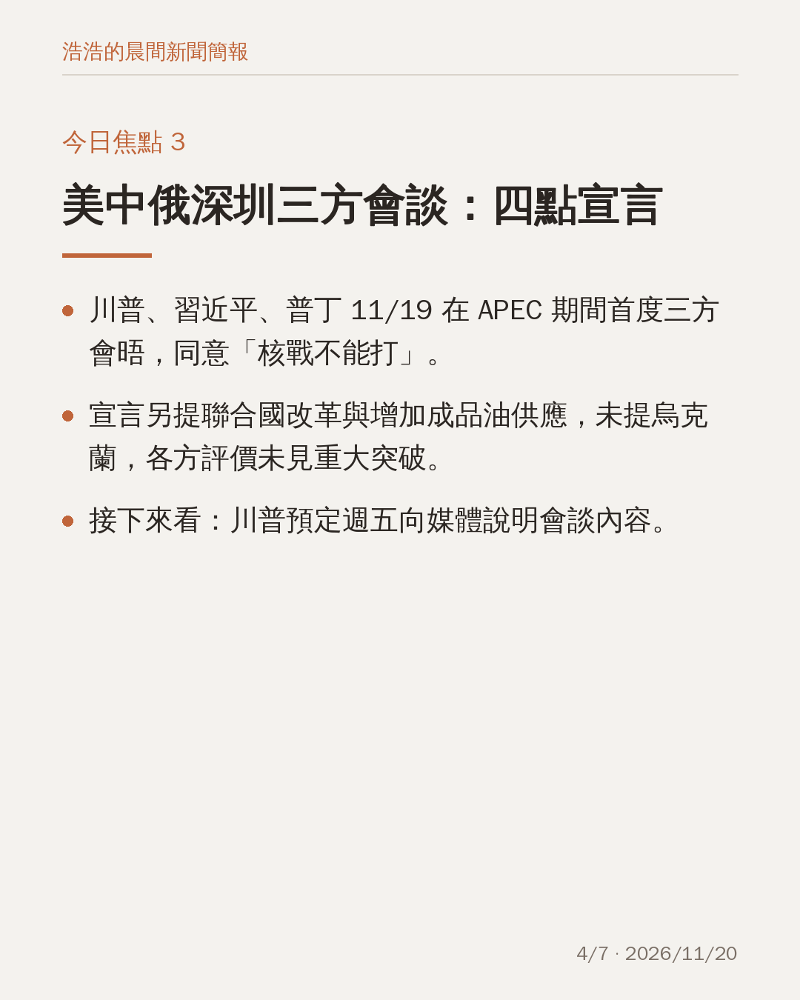
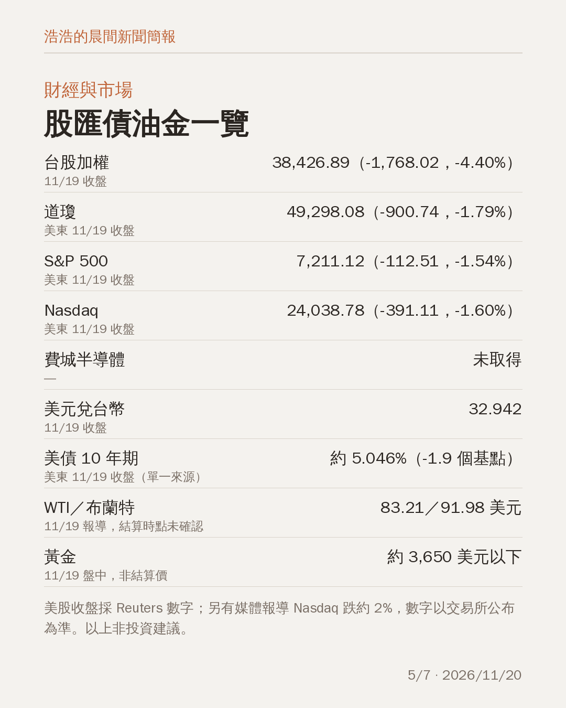
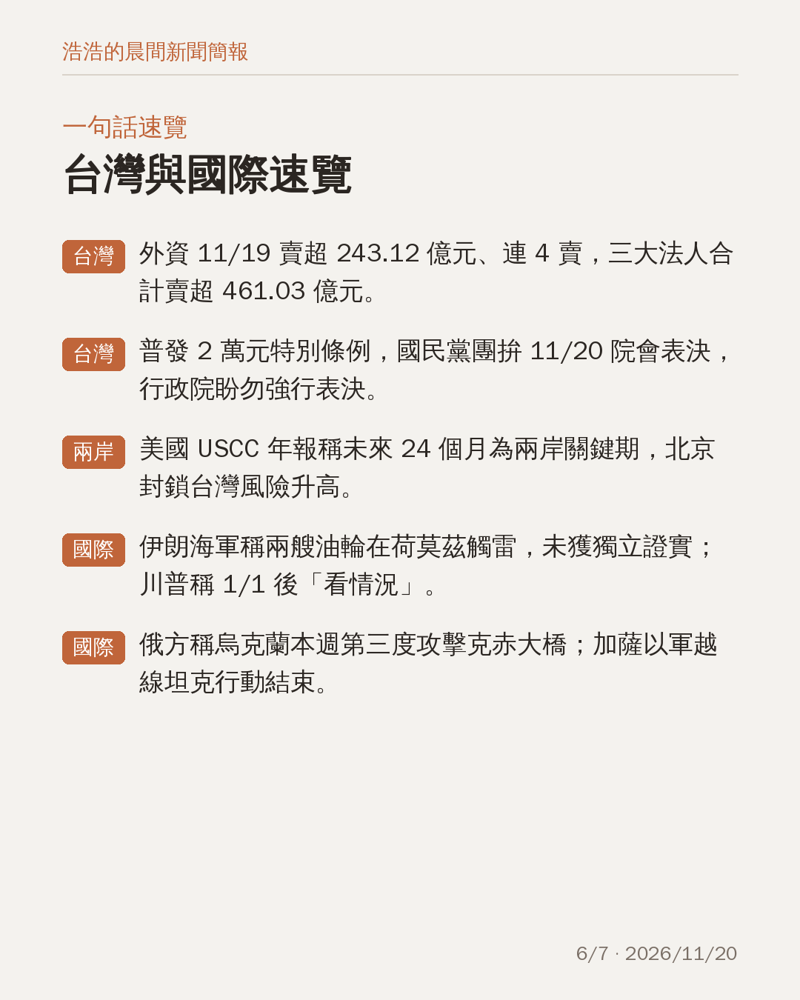
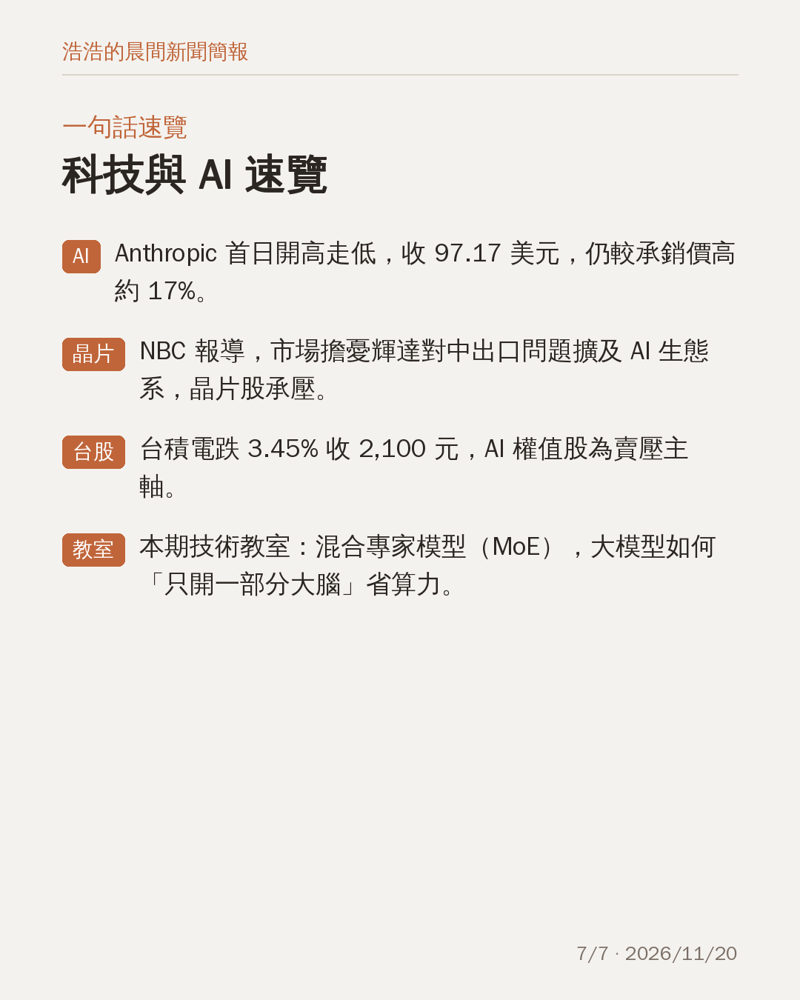

# 晨間新聞簡報｜2026年11月20日（週五）

今日三大焦點：
1. Anthropic 掛牌首日收 97.17 美元，較承銷價漲約 17%。
2. 美股大跌、台股重挫 1,768 點收 38,426.89，失守年線。
3. 美中俄深圳首度三方會談，發表四點宣言、未見重大突破。

完整簡報：https://claude.ai/artifact/LeR1TRnBNkeundPw1ALTqe

