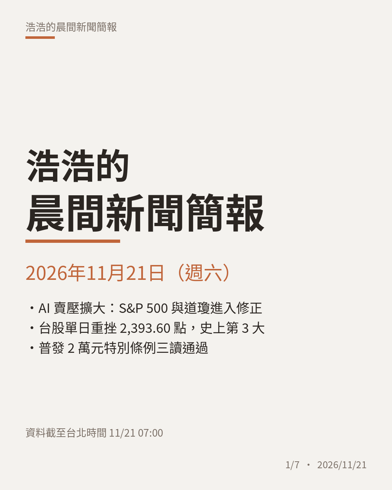
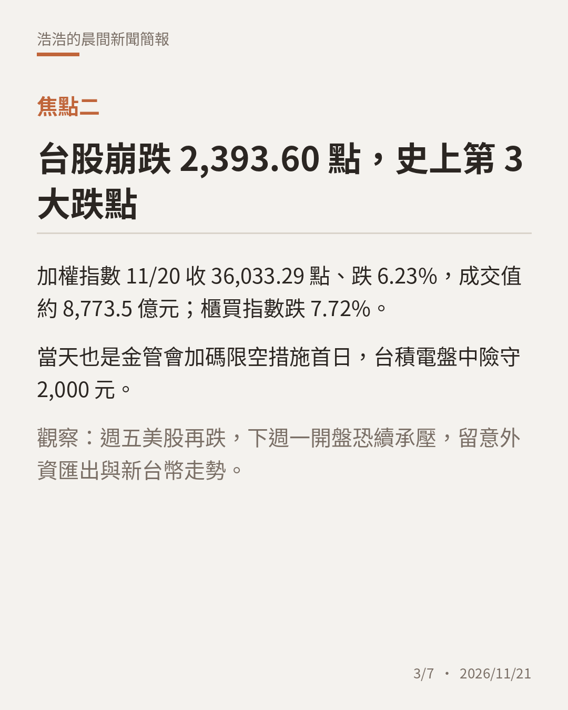
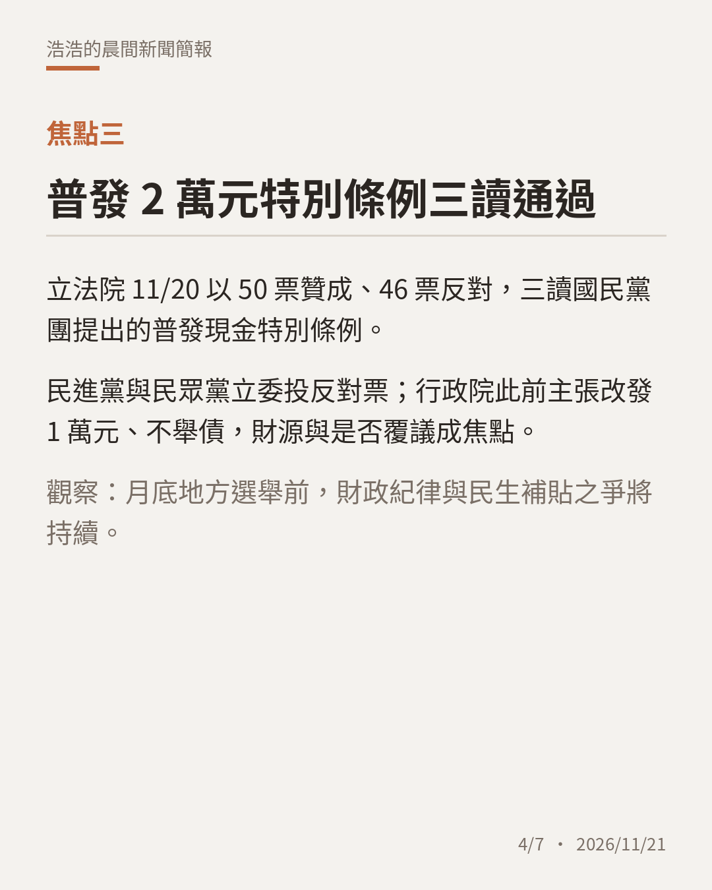
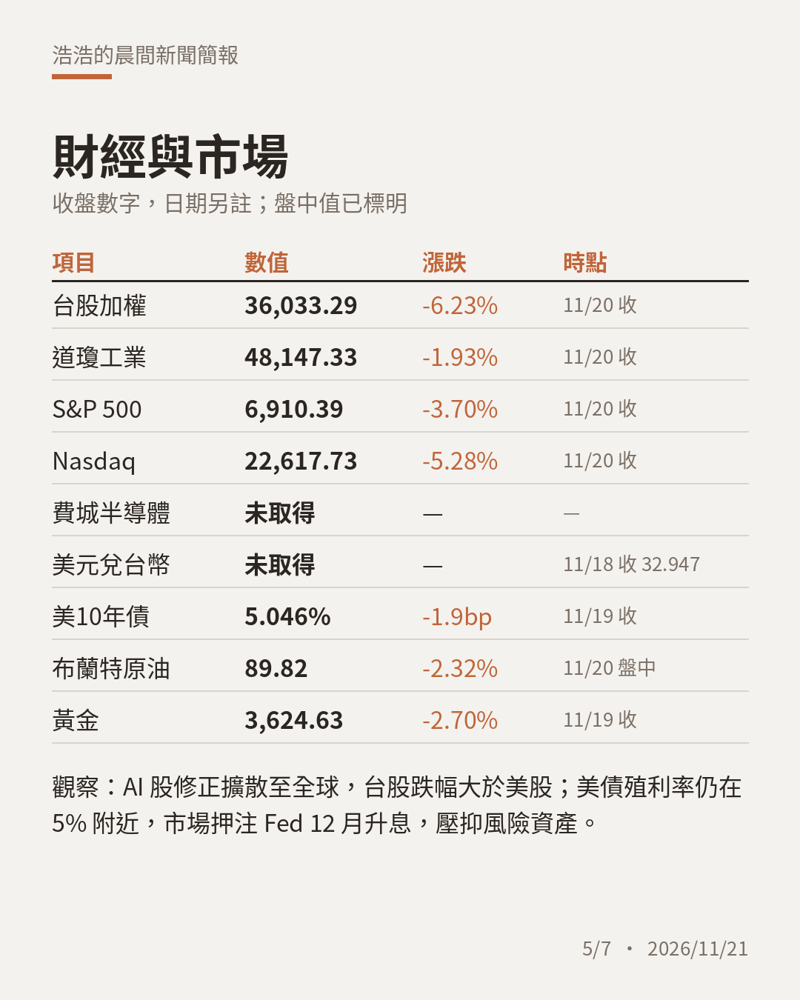
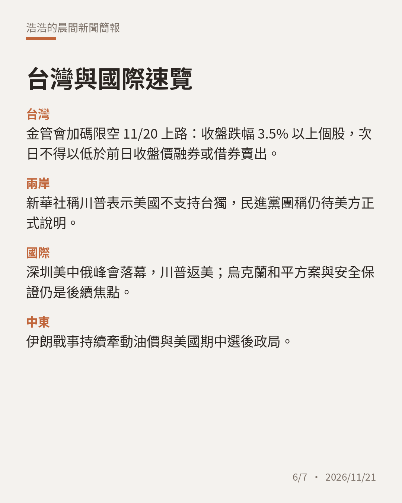
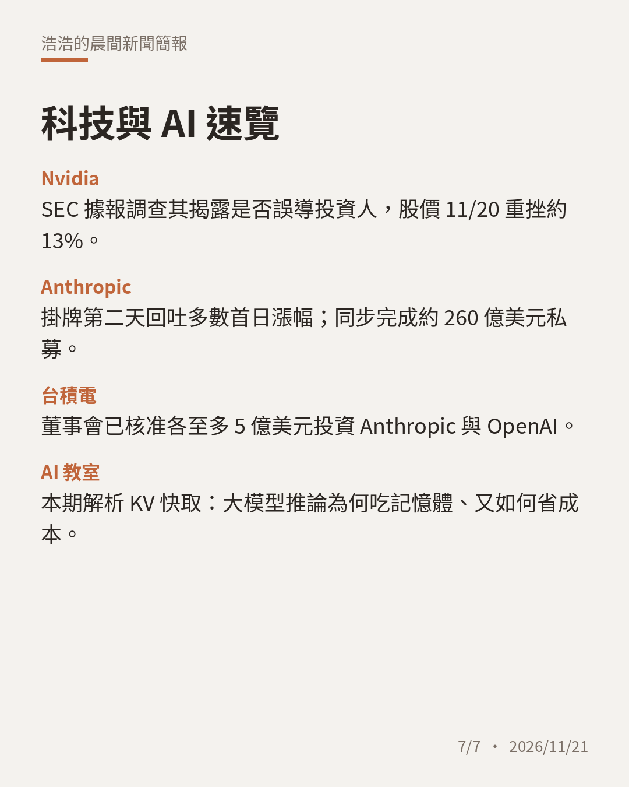

# 晨間新聞簡報｜2026年11月21日（週六）

## 今日三大焦點
1. 美股 AI 賣壓擴大：Nasdaq 11/20 跌 5.28% 抹去今年漲幅，S&P 500 與道瓊進入修正，Nvidia 跌約 13%。
2. 台股 11/20 重挫 2,393.60 點收 36,033.29，史上第 3 大跌點。
3. 普發 2 萬元特別條例以 50 比 46 三讀通過。

完整簡報：https://claude.ai/artifact/LeR1TRnBNkeundPw1ALTqe

## 圖卡

