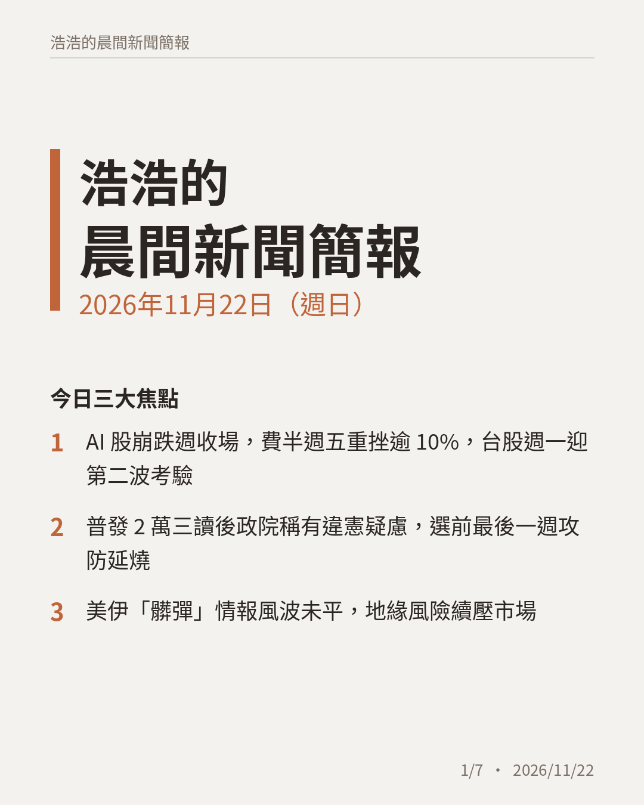
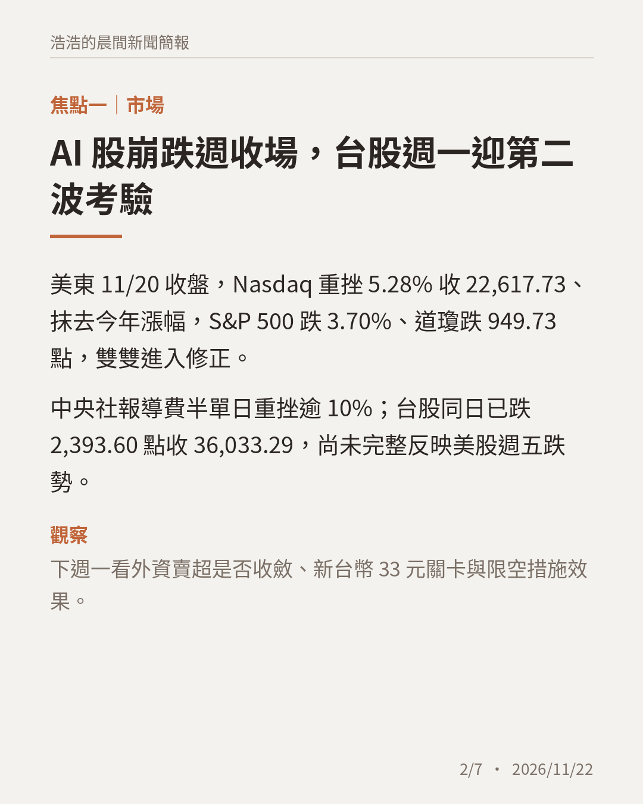
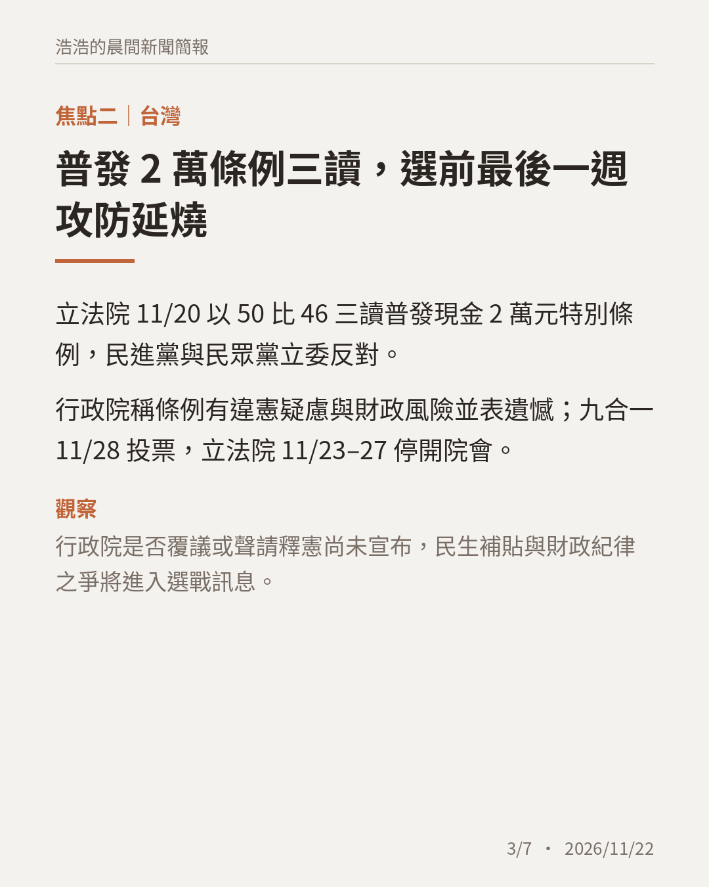
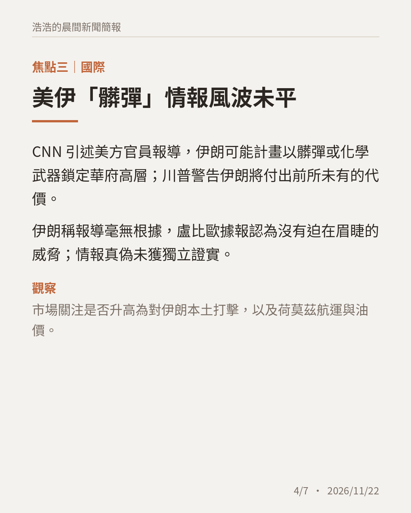
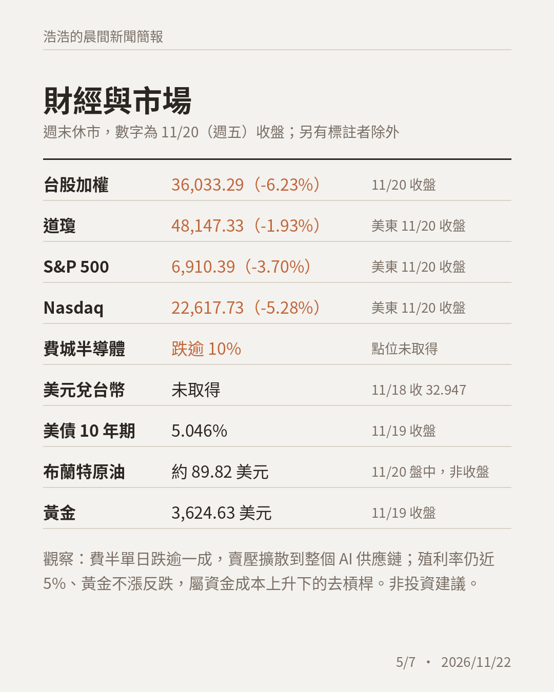
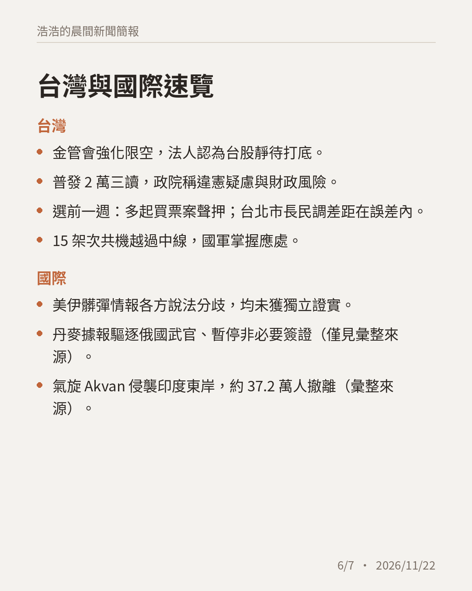
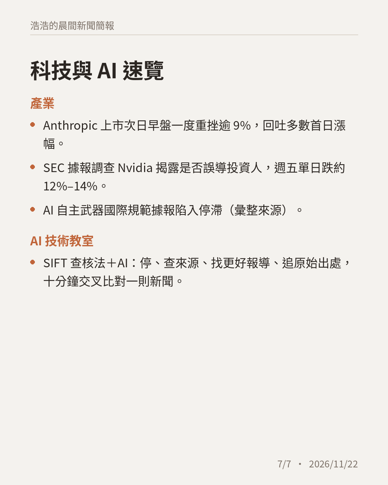

# 晨間新聞簡報｜2026年11月22日（週日）

**今日三大焦點**

1. AI 股崩跌週收場，費半週五據報重挫逾 10%，台股週一迎第二波考驗。
2. 普發 2 萬條例三讀，行政院稱有違憲疑慮，選前最後一週攻防延燒。
3. 美伊「髒彈」情報風波未平，伊朗否認，真偽未獲獨立證實。

完整簡報：https://claude.ai/artifact/LeR1TRnBNkeundPw1ALTqe

