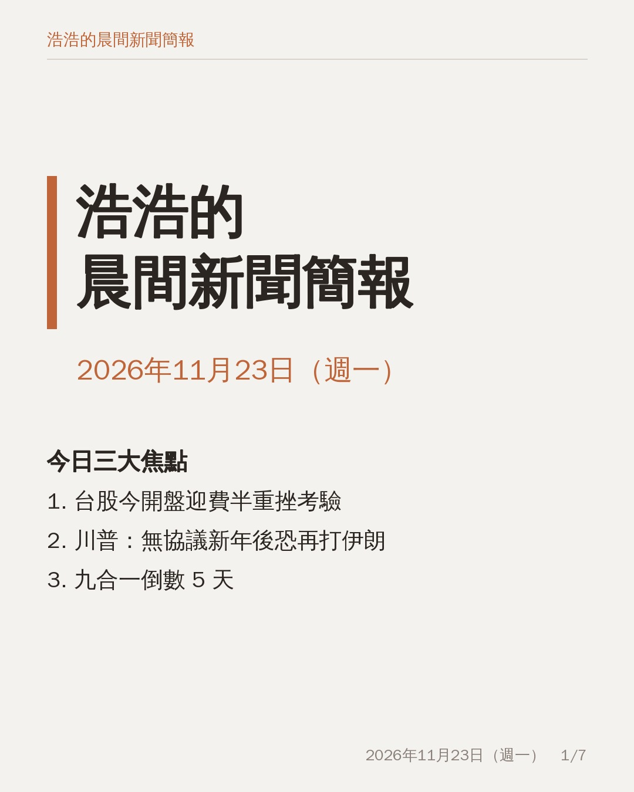
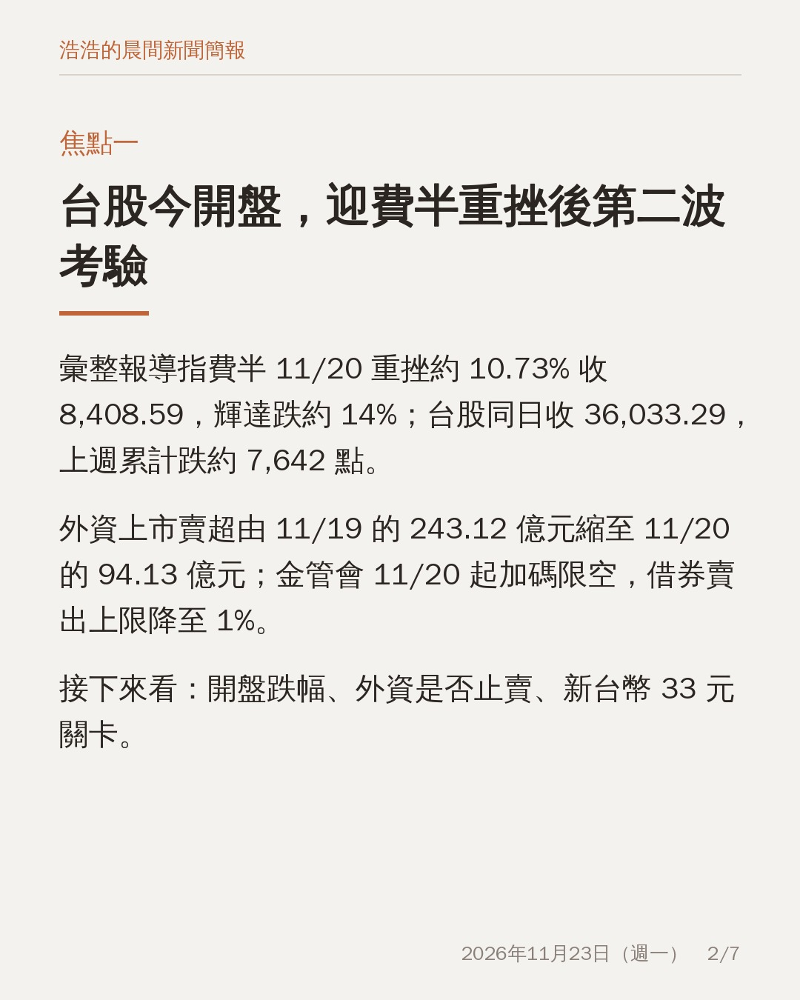
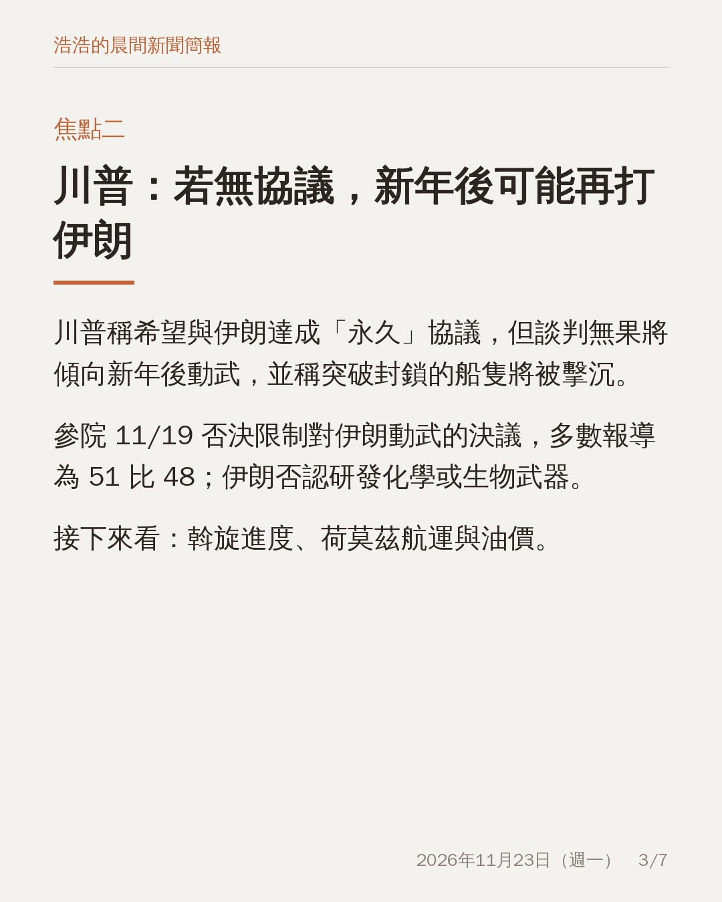
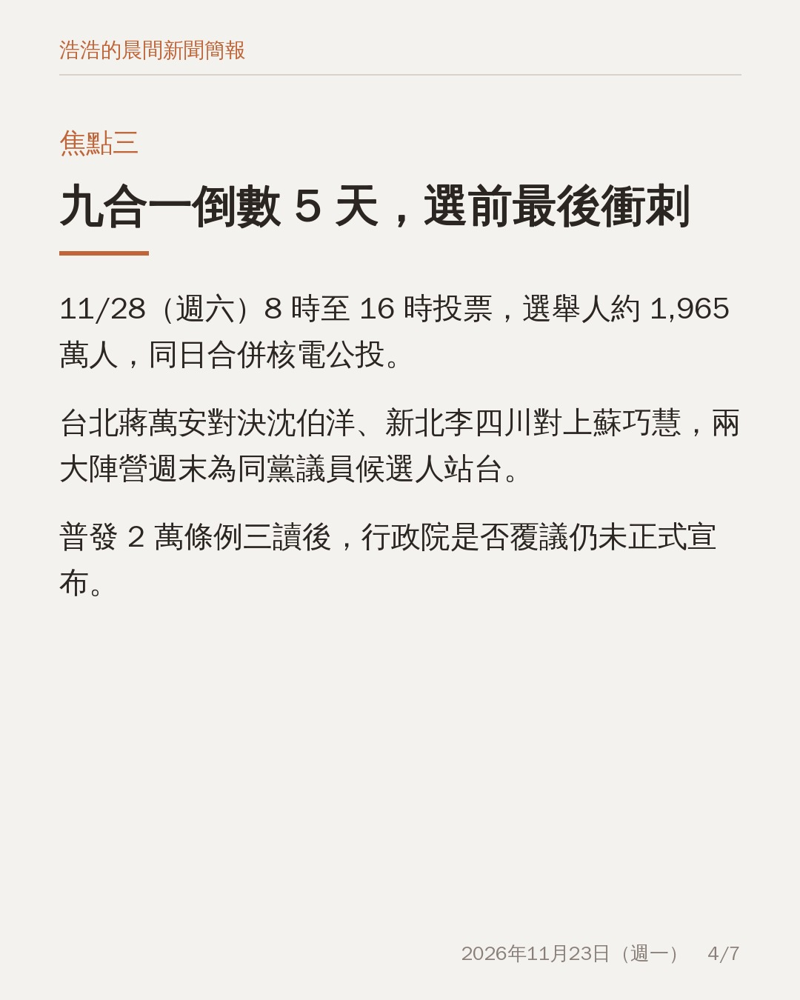
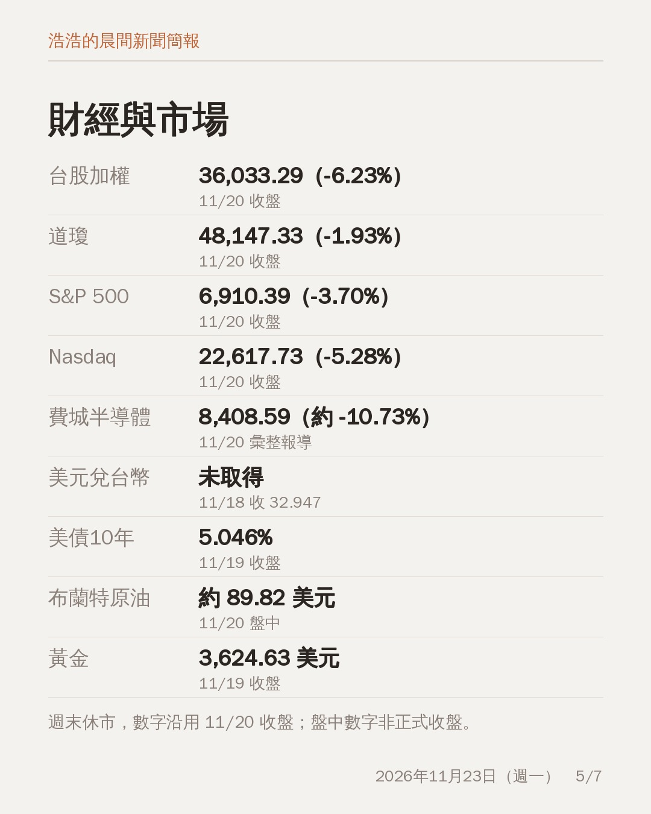
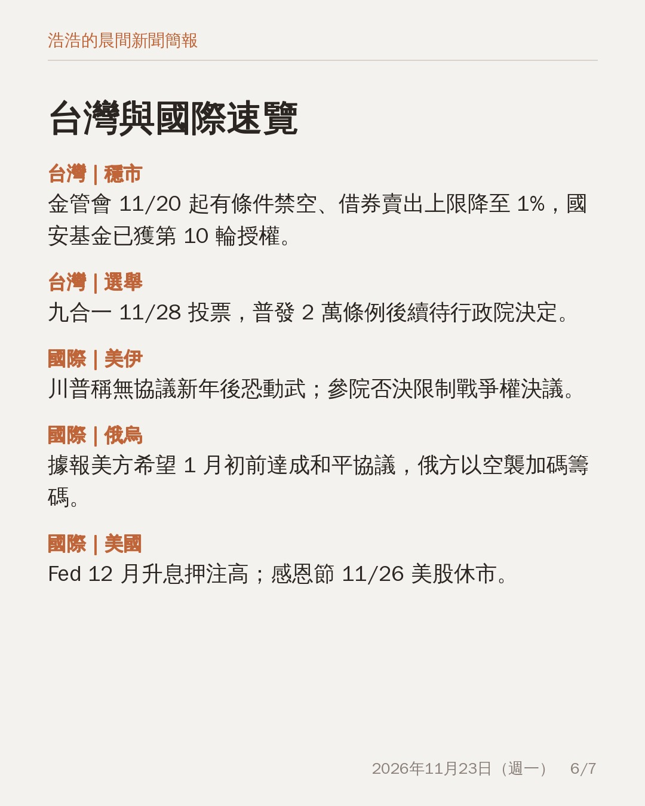
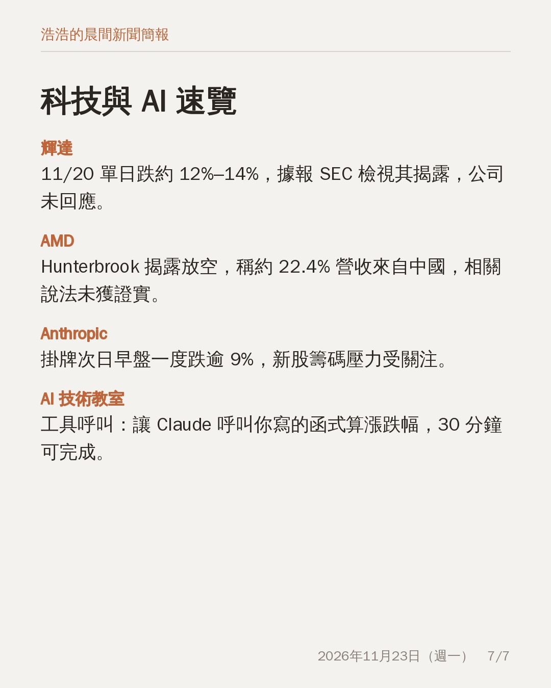

# 晨間新聞簡報｜2026年11月23日（週一）

**今日三大焦點**

1. 費半 11/20 據報重挫約 10.73%，台股今開盤迎第二波考驗，金管會加碼限空。
2. 川普稱與伊朗若無協議，新年後可能再動武；參院否決限制戰爭權決議。
3. 九合一倒數 5 天，11/28 投票並合併核電公投。

完整簡報：https://claude.ai/artifact/LeR1TRnBNkeundPw1ALTqe
