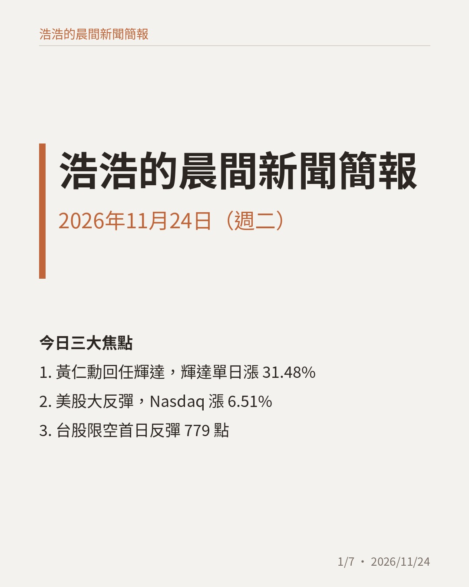
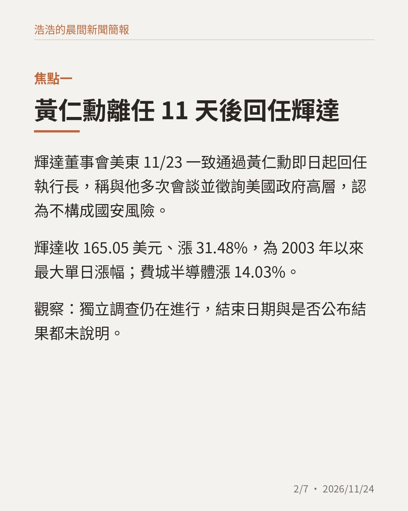
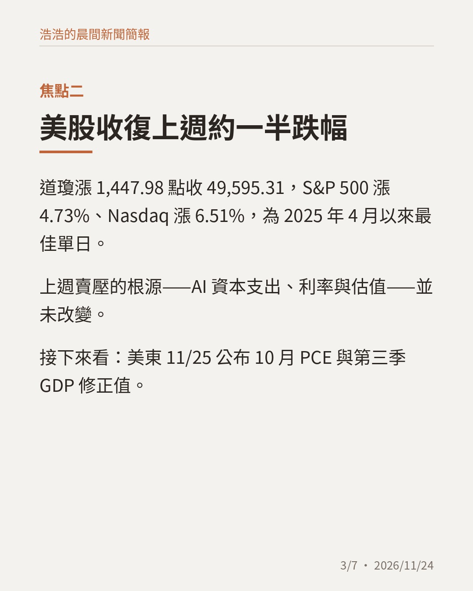
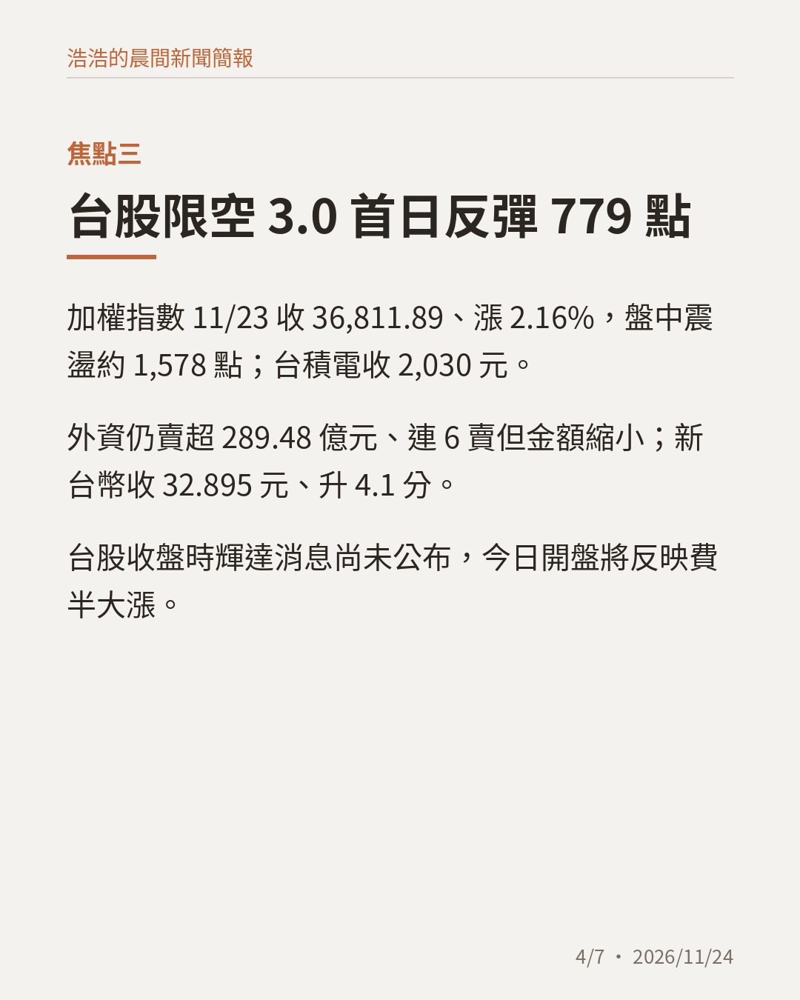
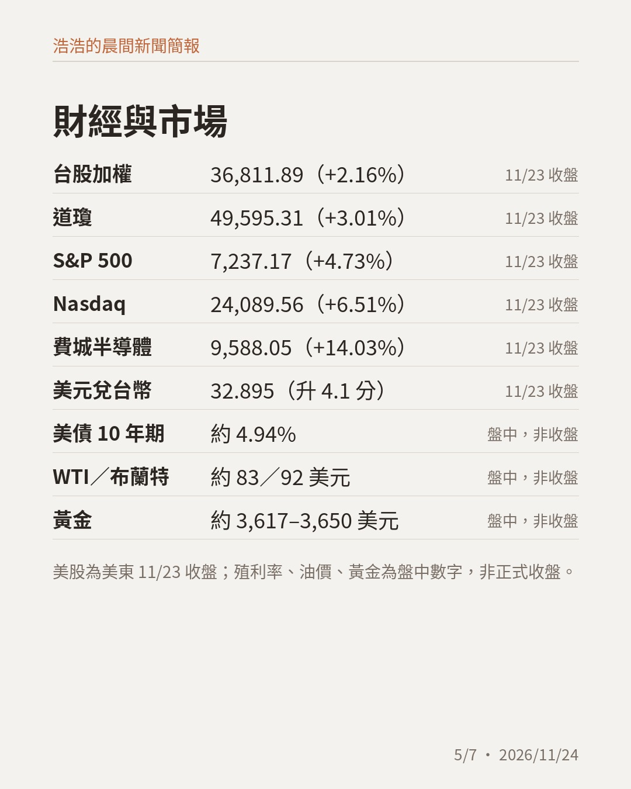
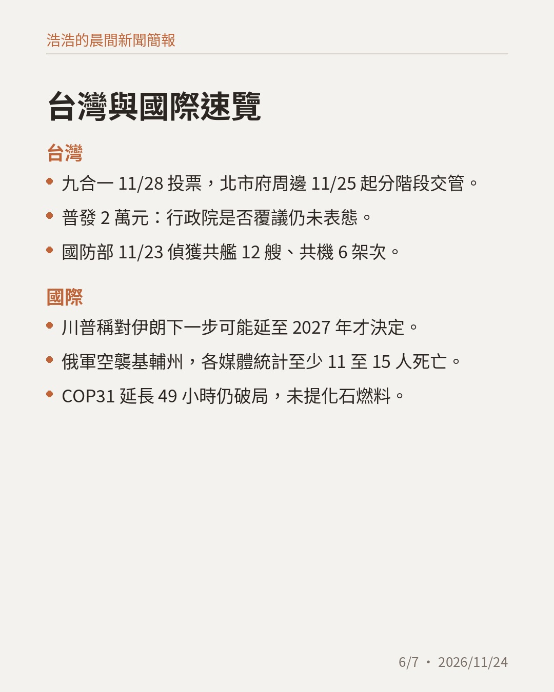

# 晨間新聞簡報｜2026年11月24日（週二）

## 今日三大焦點
1. 黃仁勳離任 11 天後回任輝達執行長，輝達收漲 31.48%、費城半導體漲 14.03%。
2. 美股收復上週約一半跌幅：道瓊收 49,595.31、Nasdaq 漲 6.51%。
3. 台股限空 3.0 首日反彈 778.6 點收 36,811.89，外資仍連 6 賣。

## 圖卡

完整簡報：https://claude.ai/artifact/LeR1TRnBNkeundPw1ALTqe
