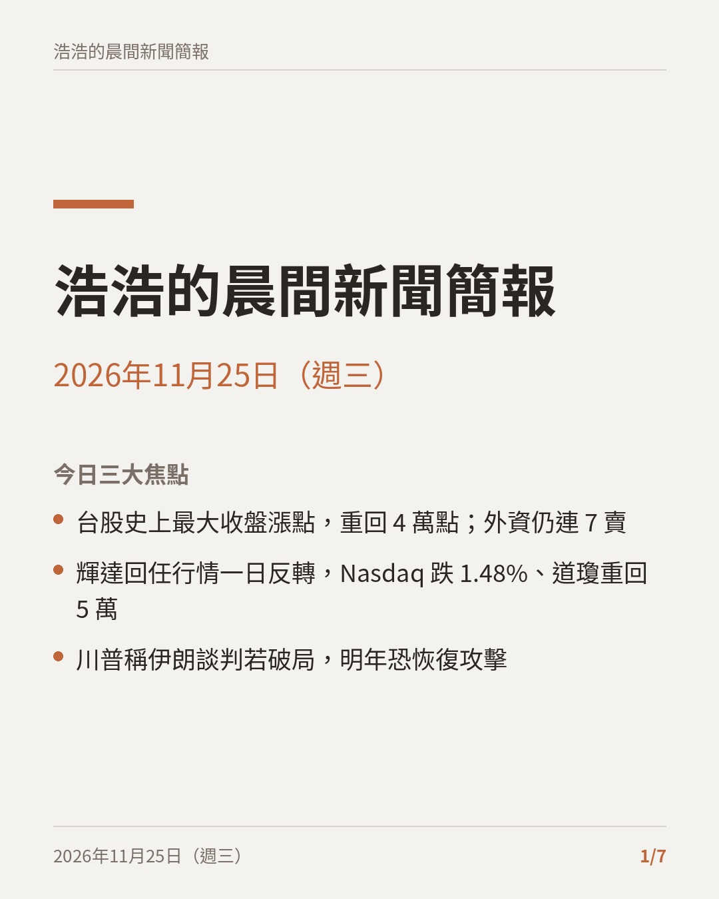
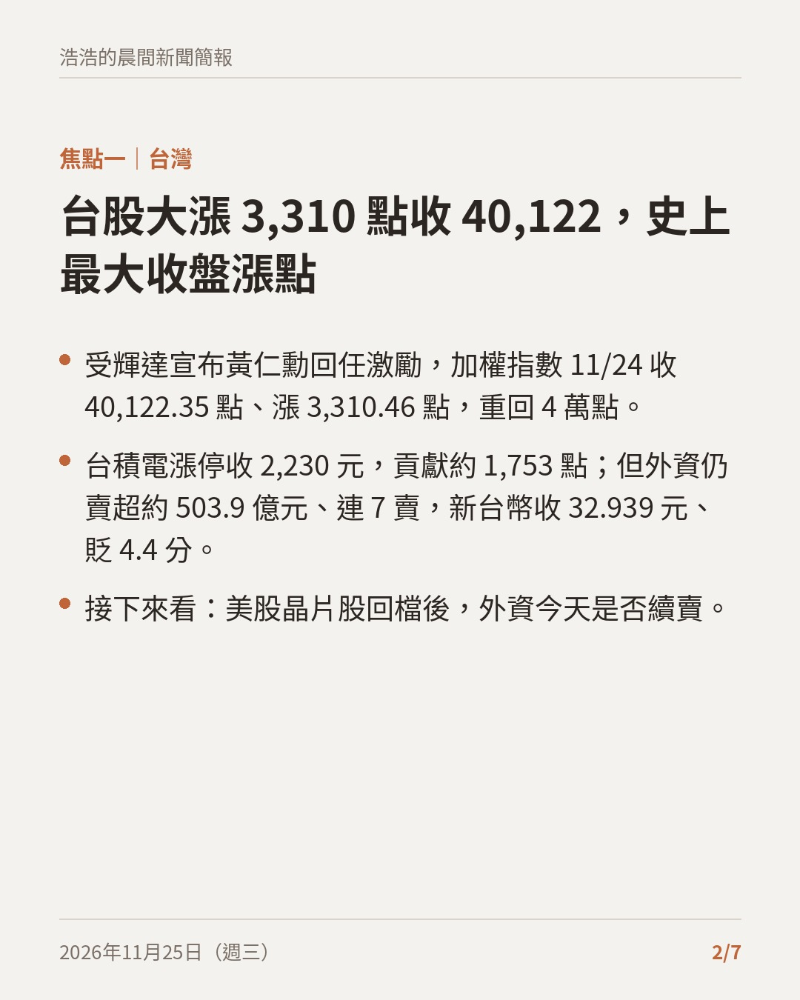
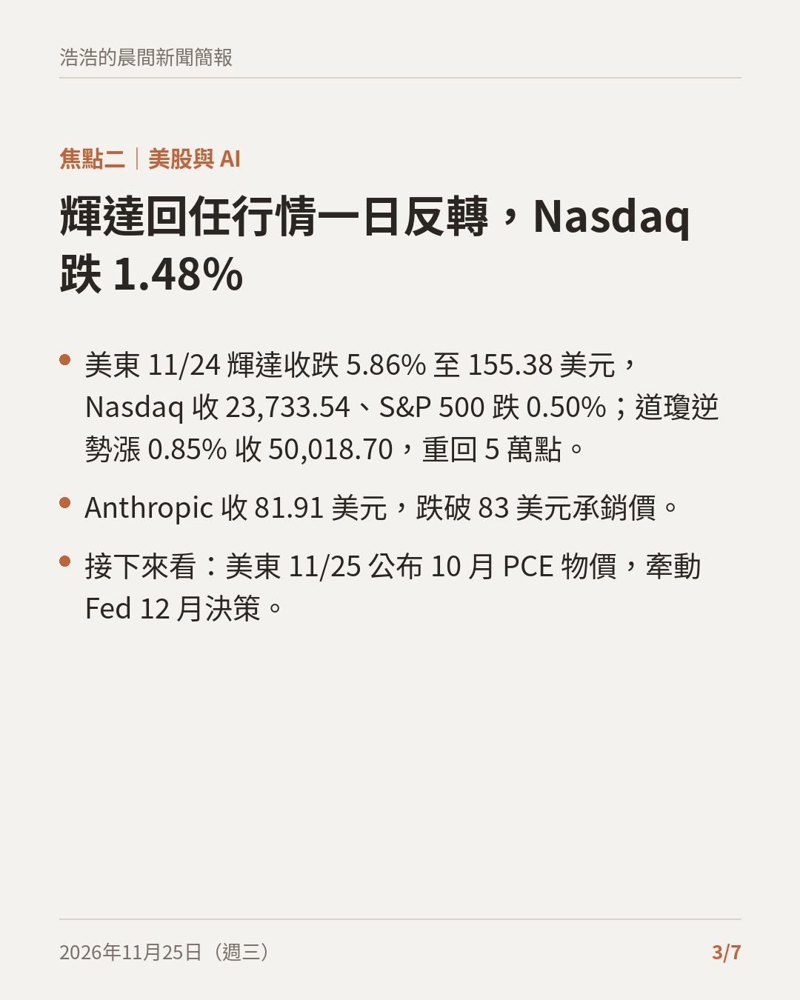
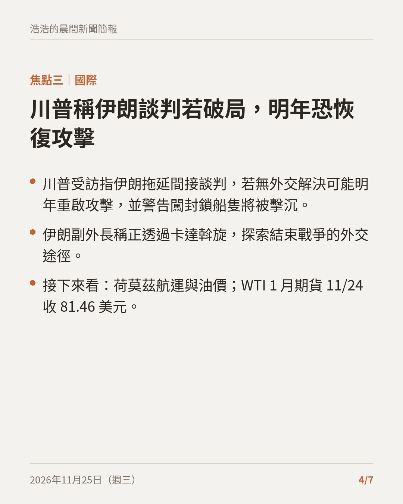
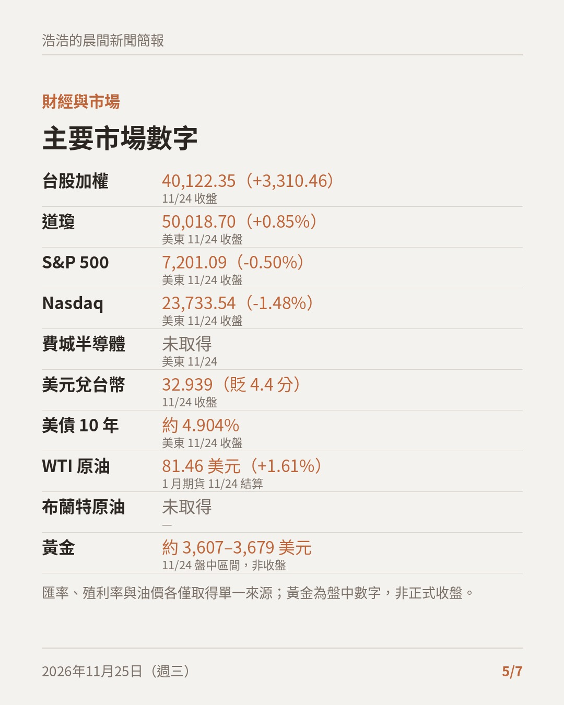
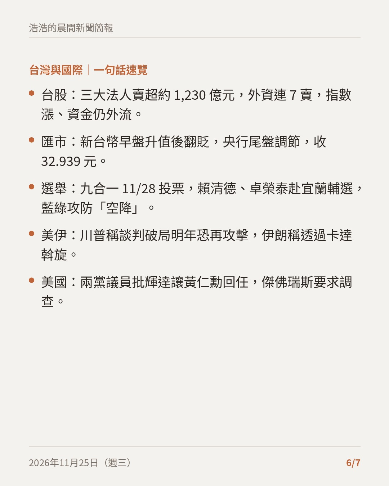
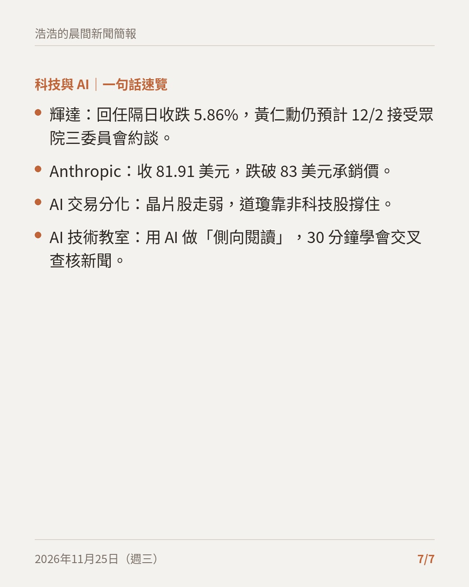

# 晨間新聞簡報｜2026年11月25日（週三）

## 今日三大焦點
1. 台股 11/24 大漲 3,310.46 點收 40,122.35，史上最大收盤漲點；外資仍賣超約 503.9 億元、連 7 賣。
2. 輝達回任行情一日反轉，收跌 5.86%；Nasdaq 跌 1.48%，道瓊漲 0.85% 收 50,018.70。
3. 川普稱伊朗談判若破局，明年恐恢復攻擊；伊朗稱正透過卡達斡旋。

## 圖卡

完整簡報：https://claude.ai/artifact/LeR1TRnBNkeundPw1ALTqe
