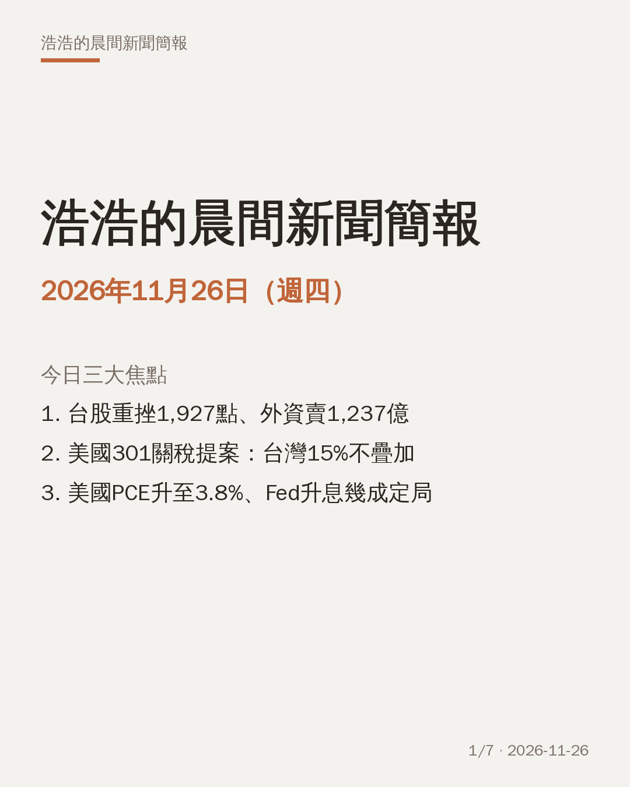
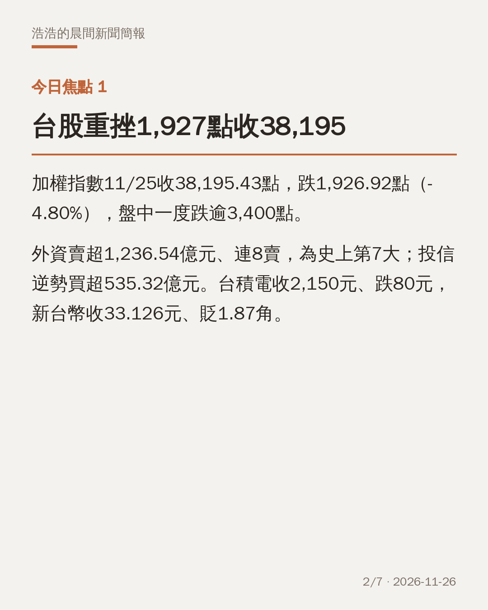
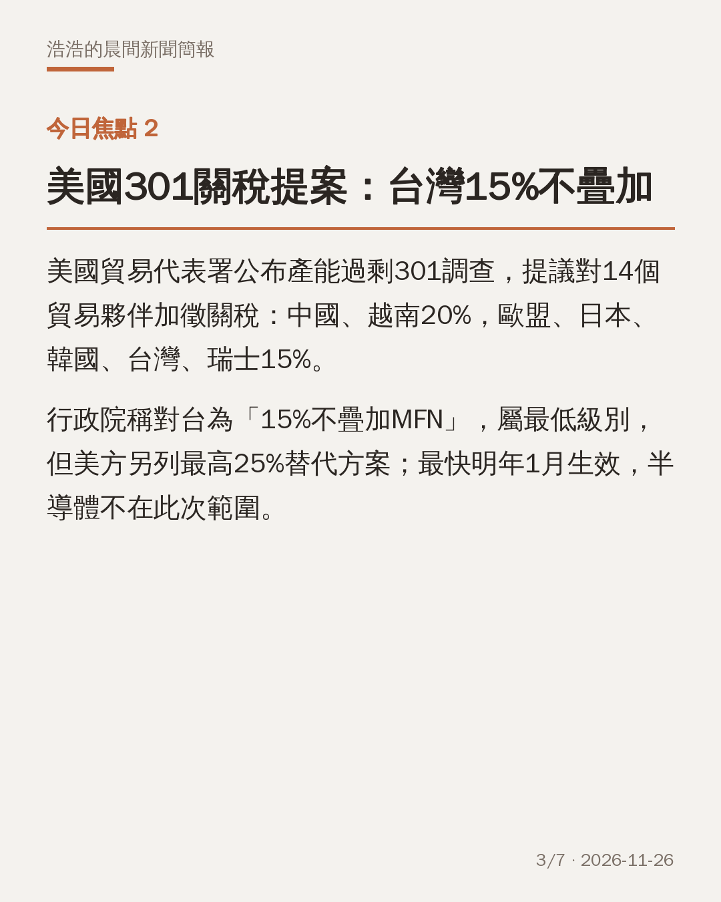
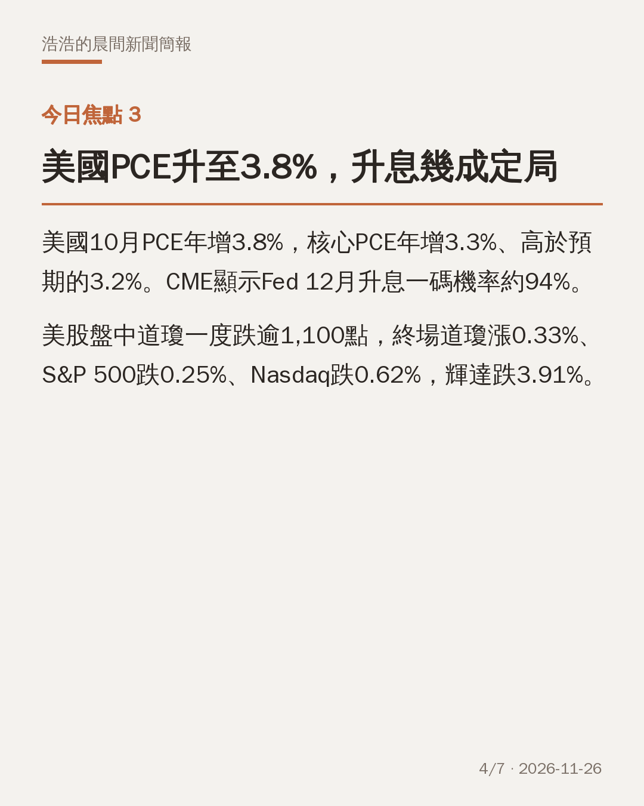
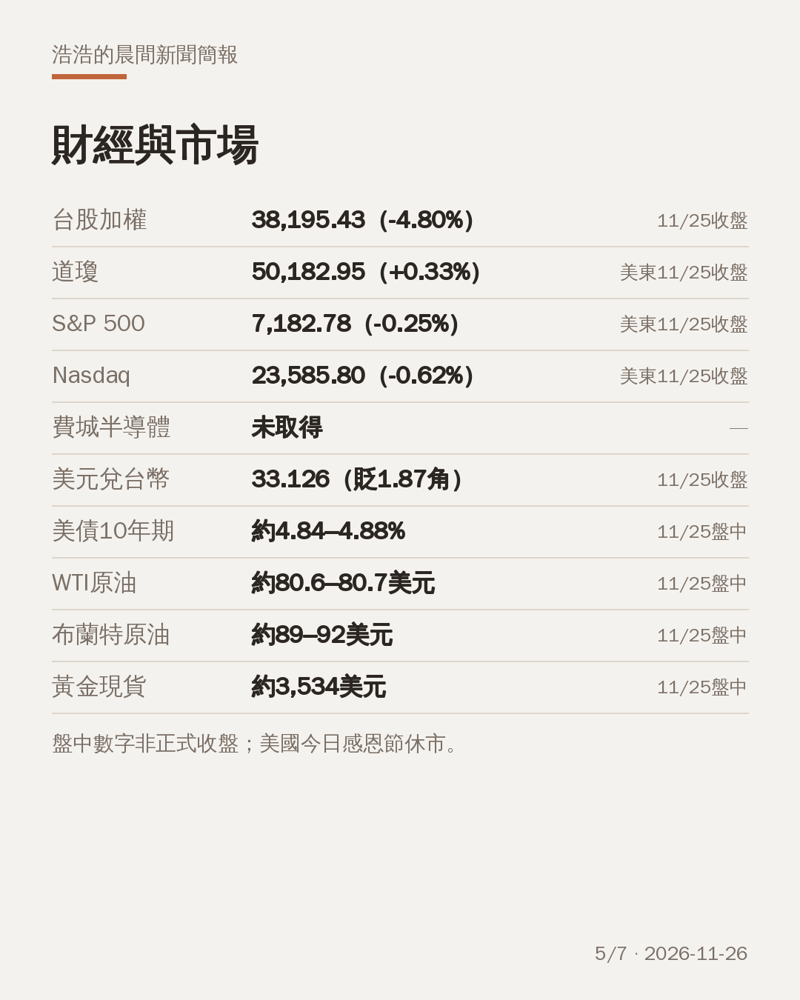
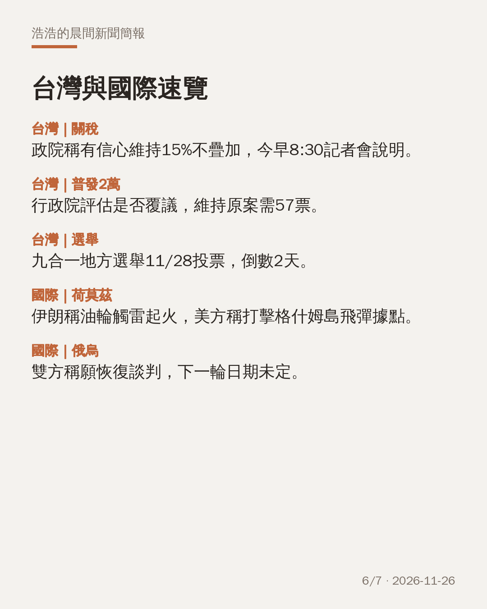
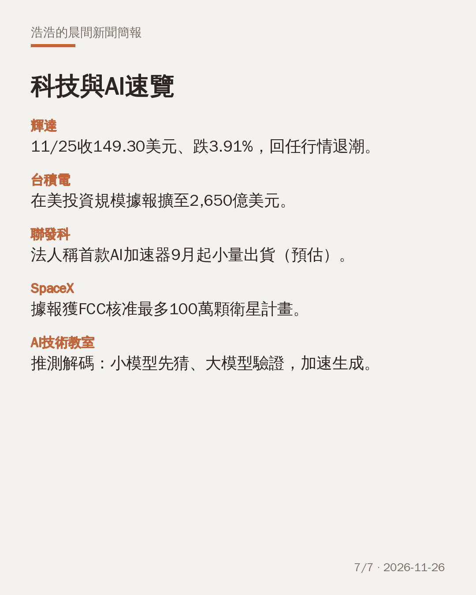

# 晨間新聞簡報｜2026年11月26日（週四）

今日三大焦點：
1. 台股重挫 1,926.92 點收 38,195.43，外資賣超 1,236.54 億元、史上第 7 大。
2. 美國 301 關稅提案：中國 20%，台灣 15% 不疊加。
3. 美國 10 月 PCE 3.8%、核心 3.3%，Fed 12 月升息幾成定局。

完整簡報：https://claude.ai/artifact/LeR1TRnBNkeundPw1ALTqe
